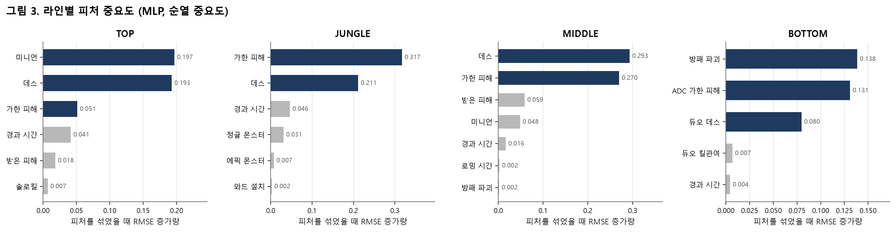
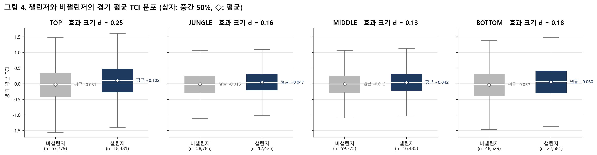

# 리그 오브 레전드 경기력 평가를 위한 TCI 모델의 설계 및 활용

**작성자:** 양혜성 (2022143002), 신구대학교

## 1. 개 요

---

리그 오브 레전드(League of Legends, 이하 LoL)는 아시안게임 정식 종목으로 채택될 만큼 대중성과 파급력이 검증된 게임이다. LoL을 플레이하는 가장 보편적인 방식은 5대5 솔로랭크 매치이며, 플레이의 일차적인 목적은 게임을 숙달하여 랭크를 올리는 데 있다. 프로게이머나 스트리머처럼 최고 수준의 소환사도 솔로랭크를 플레이하며, 이를 실력 향상과 유지를 위한 훈련 수단으로 활용한다[[1]](https://www.dailyesports.com/view.php?ud=2020081809094087763cf949c6b9_27).

솔로랭크는 매 경기 팀원이 무작위로 정해지므로, 승패는 개인의 실력뿐 아니라 팀원 운에 크게 좌우된다. 그래서 승패만으로는 그 소환사가 잘했는지 알기 어렵다. 이 보고서는 승패 대신 **경기 중 매 분마다 상대 라이너보다 얼마나 앞서 있었는지**를 하나의 점수로 나타내는 모델을 라인별로 만든다.

### 1.1 분석 데이터

Riot Games는 개발자 포털에서 경기 데이터를 무료로 제공한다[[2]](#참고문헌). 분석 대상은 2025년 1월 8일부터 4월 7일까지 한국 서버 챌린저 300명(2025년 4월 8일 기준)이 플레이한 경기 중, 초반 항복 경기를 제외한 20분 이상 경기 **38,105건**이다.

데이터는 두 종류로 되어 있다.

- **매치 데이터:** 경기 결과(승패)와 참가자 정보(포지션 등)
- **타임라인 데이터:** 1분마다 기록된 참가자 상태(골드, 경험치, 미니언 등)와 경기 중 일어난 사건(킬, 와드 설치, 포탑 파괴 등)

### 1.2 기본 방향: TCI

선행연구[[3]](https://www.kci.go.kr/kciportal/ci/sereArticleSearch/ciSereArtiView.kci?sereArticleSearchBean.artiId=ART003327764)는 미드라이너의 실력을 분 단위로 평가하는 <strong>타임라인 기여도 지수(Timeline Contribution Index, TCI)</strong>를 제안하였다. 이 보고서는 TCI를 4개 라인(TOP, JUNGLE, MIDDLE, BOTTOM)으로 넓힌다. BOTTOM은 원거리 딜러(ADC)와 서포터(SPT)를 한 팀(듀오)으로 묶는다.

TCI는 **지도학습**으로 만든다. 지도학습은 문제와 정답을 함께 보여 주며 둘의 관계를 배우게 하는 방법이다.

```
문제 (피처 x)                       정답 (타겟 y)
그 분까지의 플레이 기록     ──모델──▶   그 분의 경기 우위
(미니언, 데스, 가한 피해 …)            (골드·경험치·킬 격차 등)
```

모델이 다 배우고 나면 플레이 기록만 보고 "이 정도면 이만큼 앞서 있다"는 점수를 내놓는데, 이 점수가 **TCI**이다. TCI가 양수이면 상대보다 우세, 0이면 대등, 음수이면 열세라는 뜻이다.

$$
TCI_{LANE} (\vec{x}, t ; \theta), ~~~LANE \in \{ TOP,~JUNGLE,~MIDDLE,~BOTTOM\}
$$

이 식은 "라인마다(LANE), $t$분의 플레이 기록 $\vec{x}$를 넣으면, 학습으로 정해진 모델($\theta$)이 TCI를 계산한다"는 뜻이다.

### 1.3 선행연구와의 차이

| 구분 | 선행연구 | 이 보고서 |
|---|---|---|
| 대상 | 미드라이너만 | 4개 라인 (바텀은 듀오) |
| 데이터 | 13,890경기 | 38,105경기 |
| TCI 만드는 방법 | 주성분분석: 정답 없이 지표 5개를 하나로 압축 | 지도학습: 라인별 정답을 정하고, 플레이 기록으로 정답을 맞히는 모델을 학습 |
| 검증 방법 | TCI로 두 미드라이너의 골드 격차 부호를 맞힘 (81%) | 정답(타겟)의 부호로 경기 승패를 맞힘 (4개 라인 합 95.6%) |
| 활용 | 소환사별 TCI의 단순 평균으로 실력 구분 | ① 승패와 분리된 실력 평가 ② 시간대별 실력 프로필 |

---

## 2. 변수 설정

---

### 2.1 타겟 변수 설정

타겟은 모델이 맞혀야 할 정답, 즉 **"그 라인이 잘하고 있다"의 기준**이다. 라인마다 역할이 다르므로 기준도 라인별로 다르게 정하였다. 기준은 먼저 게임에 대한 이해(도메인 지식)로 정하고, 그다음 실제 경기에 적용해 승패를 얼마나 맞히는지로 확인하였다.

#### 2.1.1 라인별 타겟

모든 지표는 같은 라인의 상대와 비교한 **누적 격차**(그 분까지 쌓인 값의 블루 − 레드)로 계산한다.

| 라인 | 타겟 | 이유 |
|---|---|---|
| TOP | 경험치 격차 + 포탑 골드 격차 | 탑은 다른 라인과 떨어져 1:1 라인전을 오래 한다. 레벨(경험치)이 앞서면 라인을 주도하고, 그 우위가 포탑 방패와 포탑 파괴로 이어진다 |
| JUNGLE | 킬 격차 + 어시스트 격차 | 정글러의 핵심 역할은 갱킹과 교전으로 다른 라인을 돕는 것이다 |
| MIDDLE | 킬 격차 + 어시스트 격차 | 미드는 맵 가운데에서 양쪽 라인과 정글로 로밍하며 교전에 관여하는 일이 많다 |
| BOTTOM | 미니언 격차 + 골드 격차 (원딜 + 서포터 합산) | 원딜의 파밍에 서포터의 와드 제거(CS +1)와 서포터 골드까지 합쳐, 듀오 전체의 성장을 나타낸다 |

- **포탑 골드:** 데이터에 선수별 포탑 골드가 따로 없어서, TOP 라인에서 깬 방패 1개를 125골드, 포탑 1개를 250골드로 계산하였다.
- **와드 제거가 CS에 포함되는지 확인:** 표본 30경기에서 서포터가 와드를 깬 445번의 1분 구간 중, CS가 깬 와드 수만큼 오르지 않은 경우는 한 번도 없었다. 와드를 안 깬 1분 구간에서는 CS가 오른 경우가 35%뿐이었다. 따라서 와드 제거는 CS(미니언 수)에 포함되어 있다고 판단하였다.
- **와드 설치를 뺀 과정:** 처음에는 서포터의 시야 역할을 넣으려고 BOTTOM 타겟에 와드 설치를 포함하였다. 그런데 와드 설치 격차는 승패를 57.4%만 맞혀 동전 던지기(50%)와 큰 차이가 없었고, 오히려 결합 타겟의 정확도를 떨어뜨려서 뺐다.

#### 2.1.2 정규화: 단위가 다른 지표를 합치는 방법

골드 격차는 수천 단위이고 킬 격차는 몇 개 단위이다. 그대로 더하면 숫자가 큰 골드가 결과를 거의 다 차지한다. 그래서 각 지표를 **표준편차(값이 보통 퍼져 있는 크기)로 나눠** 같은 척도로 맞춘 뒤 평균하였다.

$$
y_{t} = \frac{1}{K} \sum_{k=1}^{K} \frac{\Delta_{k,t}}{\sigma_k}
$$

- $\Delta_{k,t}$: $t$분에 $k$번째 지표의 격차 (예: 골드 격차 1,000)
- $\sigma_k$: 그 지표의 표준편차 (예: BOTTOM 골드 격차는 보통 2,103 정도 퍼져 있음)
- $K$: 합치는 지표 개수. $\frac{1}{K}\sum$는 "나눈 값들을 평균한다"는 뜻

예를 들어 BOTTOM 듀오가 미니언 23.58개, 골드 2,102.89 앞서 있으면 두 지표가 모두 1이 되어 $y = (1+1)/2 = 1$이다. 미니언이든 골드든 "평소 퍼진 정도의 한 배만큼 앞섰다"는 같은 의미가 된다.

z-점수와 비슷하지만 **평균은 빼지 않았다.** 그래야 $y = 0$이 "상대와 대등함"을 뜻하고, 레드 팀의 값은 블루 팀 값의 부호만 바꾼 것이 된다.

| 라인 | 지표별 표준편차 |
|---|---|
| TOP | 경험치 1,504.41, 포탑 골드 395.67 |
| JUNGLE | 킬 3.33, 어시스트 3.30 |
| MIDDLE | 킬 3.04, 어시스트 3.07 |
| BOTTOM | 미니언 23.58, 골드 2,102.89 |

#### 2.1.3 타겟 검증: 승패를 맞히는가

"타겟이 양수이면 블루 팀 승리"로 예측했을 때 맞힌 비율이다. 4개 라인의 타겟을 합친 팀 단위도 함께 보았다.

**표 1. 타겟의 승패 예측 정확도 (38,105경기)**

| 단위 | 5분 | 10분 | 15분 | 20분 | 경기 종료 |
|---|---|---|---|---|---|
| TOP | 0.528 | 0.556 | 0.591 | 0.640 | 0.824 |
| JUNGLE | 0.565 | 0.591 | 0.626 | 0.691 | 0.868 |
| MIDDLE | 0.554 | 0.575 | 0.608 | 0.664 | 0.844 |
| BOTTOM | 0.543 | 0.562 | 0.592 | 0.637 | 0.748 |
| 4개 라인 합 | 0.575 | 0.624 | 0.684 | 0.758 | **0.956** |

- **경기 종료 시점:** 4개 라인의 타겟을 합치면 경기 종료 시점에 <strong>95.6%</strong>의 승패를 맞힌다. 라인별로 정한 기준이 경기의 실제 우위를 잘 나타낸다는 근거이다.
- **시간이 갈수록:** 정확도가 높아진다. 초반 한 라인의 우위만으로는 5대5 경기의 결과가 정해지지 않기 때문이다. TCI는 승패를 맞히는 점수가 아니라 과정의 우위를 재는 점수이므로, 초반 정확도가 낮은 것은 자연스럽다.
- **TOP·BOTTOM:** 결합 타겟(82.4%, 74.8%)이 경험치 하나(84.1%)나 골드 하나(85.3%)보다 조금 낮다. 그래도 포탑 골드와 미니언을 넣은 것은, 골드만 쓰면 킬 골드까지 섞여 탑의 포탑 압박이나 바텀 듀오의 파밍·와드 제거 같은 라인 본연의 역할이 드러나지 않기 때문이다.

### 2.2 라인별 피처 설정

피처는 모델이 정답을 맞힐 때 보는 단서, 즉 **플레이 기록**이다.

#### 2.2.1 피처를 고른 원칙

1. **방식은 누적 격차 하나로 통일한다.** 제공된 예제 코드(`data_process_sample.py`)는 누적, 격차, 시점(1분 동안의 변화량) 방식을 보여 주며 하나로 통일하라고 한다. 타겟과 같은 누적 격차를 쓰면 상대 라이너와 바로 비교할 수 있고, 입력과 출력의 기준이 같아진다. 킬·데스처럼 사건으로 기록되는 값도 분마다 횟수를 쌓은 뒤 격차를 구했다.
2. **정답에 쓴 지표는 단서로 쓰지 않는다.** 정답이 문제에 들어 있으면 모델이 플레이와 우위의 관계를 배우지 않고 답을 베끼기만 한다. 그래서 TOP은 경험치·포탑, JUNGLE·MIDDLE은 킬·어시스트, BOTTOM은 미니언·골드를 피처에서 뺐다. BOTTOM은 와드 제거도 뺐다. 와드를 깨면 CS가 오르므로, 와드 제거가 이미 정답인 미니언 격차 안에 들어 있기 때문이다. JUNGLE·MIDDLE은 골드와 경험치도 뺐다. 킬·어시스트로 받은 보상이 섞여 있어 정답이 간접적으로 새어 들어가기 때문이다.
3. **정답을 만들어 내는 원인은 쓴다.** 예를 들어 BOTTOM의 킬관여는 골드를 버는 원인이므로 피처로 썼다.

#### 2.2.2 라인별 피처

| 라인 | 피처 | 고른 이유 |
|---|---|---|
| TOP | 미니언, 가한 피해, 받은 피해, 솔로킬, 데스 | 라인전 유지력(미니언), 1:1 싸움(솔로킬, 피해), 생존(데스) |
| JUNGLE | 정글 몬스터, 에픽 몬스터, 데스, 와드 설치, 가한 피해 | 성장(정글 몬스터), 오브젝트(드래곤·전령·바론 등), 시야, 교전 참여 |
| MIDDLE | 미니언, 가한 피해, 받은 피해, 데스, 방패 파괴, **로밍 시간** | 라인 관리, 교전 딜링, 라인 압박, 로밍 |
| BOTTOM | ADC 가한 피해, 듀오 킬관여, 듀오 데스, 방패 파괴 | 원딜 딜링, 2:2 교전, 생존, 라인 압박 |

**로밍 시간:** 미드 타겟을 킬·어시스트로 정한 이유가 로밍이므로, 로밍을 직접 재는 피처를 만들었다. 미드 라인은 맵의 대각선 위에 있다. 그래서 매 분 미드라이너의 위치가 이 선에서 1,500 이상 떨어져 있으면 "로밍 중"으로 세었다.

#### 2.2.3 피처 점검

각 피처가 정답과 함께 움직이는지 상관계수(+1에 가까우면 같이 오르고, −1에 가까우면 반대로 움직임)로 확인하였다.

**표 2. 피처와 타겟의 상관계수**

| 라인 | 상관계수 |
|---|---|
| TOP | 미니언 +0.64, 가한 피해 +0.50, 받은 피해 −0.12, 솔로킬 +0.52, 데스 −0.65 |
| JUNGLE | 정글 몬스터 +0.24, 에픽 몬스터 +0.32, 데스 −0.62, 와드 설치 +0.06, 가한 피해 +0.58 |
| MIDDLE | 미니언 +0.08, 가한 피해 +0.56, 받은 피해 −0.21, 데스 −0.64, 방패 파괴 +0.17, 로밍 시간 +0.02 |
| BOTTOM | ADC 가한 피해 +0.57, 듀오 킬관여 +0.50, 듀오 데스 −0.57, 방패 파괴 +0.57 |

- **방향은 모두 예상대로였다.** 우위를 만드는 플레이(미니언, 가한 피해, 킬관여)는 +, 손해를 나타내는 플레이(데스, 받은 피해)는 −이다. 4개 라인 모두 **데스**가 가장 강한 −였다. 죽으면 그동안 경험치, 미니언, 교전 기회를 모두 잃기 때문이다.
- **로밍 시간은 거의 0(+0.02)이었다.** 로밍을 많이 간다고 킬·어시스트가 저절로 생기지 않는다는 뜻이다. 대신 가한 피해(+0.56)와 데스(−0.64)가 강했다. 즉 미드는 **로밍의 양보다, 교전에서 피해를 넣으면서 살아남는 것**이 킬·어시스트를 만든다.
- **데스와 킬이 겹치지 않는가?** 미드가 상대 미드를 잡으면 내 킬(정답)과 상대 데스(피처)가 함께 오른다. 그래서 정글러·미드라이너의 데스 중 상대 같은 라인에게 당한 비율을 세어 보았다. 정글은 29.5%(394,679번 중 116,357번), 미드는 32.8%(401,809번 중 131,954번)였다. 나머지 약 70%는 다른 라인에게 당한 데스이므로, 데스는 정답을 베낀 값이 아니라 "맵 전체에서 살아남는 능력"이라는 별도의 정보로 보고 피처로 남겼다.

---

## 3. 경기력 지표 모델링

---

### 3.1 모델 선정

#### 3.1.1 문제의 형태

입력은 그 분의 피처 5~6개와 경과 시간이고, 출력은 숫자(우위 점수)이다. 정답이 숫자이므로 **회귀** 문제이다. 학습 데이터는 "한 경기 · 한 라인 · 한 진영 · 한 분"을 한 줄로 만들어, 라인마다 약 210만 줄이 되었다.

모델이 얼마나 정확한지는 **예측과 정답의 차이**로 잰다.

$$
MSE = \frac{1}{N}\sum_{i=1}^{N}(y_i - \hat{y}_i)^2
$$

$y_i$는 정답, $\hat{y}_i$는 모델의 예측, $N$은 데이터 수이다. 차이를 제곱해서 평균한 값이 MSE이고, 작을수록 정확하다. 제곱하는 이유는 차이가 +든 −든 오차로 똑같이 세고, 크게 틀린 경우를 더 무겁게 보기 위해서이다. 보고서에는 MSE의 제곱근인 RMSE와, 정답의 변화를 모델이 몇 % 설명했는지를 나타내는 $R^2$(1이면 완벽)를 함께 적었다.

#### 3.1.2 비교한 모델: 세 가지 판단 방식

판단하는 방식이 다른 8개 모델을 비교하였다. 크게 세 가지로 나뉜다.

| 방식 | 모델 | 판단하는 방법 (한 줄 요약) |
|---|---|---|
| 선형 | 선형 회귀, 릿지, 라쏘 | 피처마다 정해진 점수를 곱해서 더한다 |
| 트리·부스팅 | 결정 나무, 랜덤 포레스트, XGBoost, LightGBM | "미니언 격차가 10개보다 많은가?" 같은 질문을 이어 가며 값을 찾는다 |
| 신경망 | MLP | 여러 뉴런이 피처를 각자 다른 비율로 섞어 판단하고, 그 결과를 더한다 |

- **릿지·라쏘:** 선형 회귀에 "점수를 너무 크게 주지 마라"는 벌점을 더한 것이다. 벌점이 있으면 데이터의 우연한 패턴을 덜 외운다. 라쏘는 쓸모없는 피처의 점수를 아예 0으로 만들어 스스로 피처를 고른다.
- **랜덤 포레스트:** 서로 다른 데이터로 학습한 결정 나무 여러 개의 답을 평균한다.
- **XGBoost·LightGBM:** 나무를 하나씩 차례로 만들되, 새 나무가 앞의 나무들이 틀린 만큼을 고쳐 나간다(부스팅). LightGBM은 이 방식을 대용량 데이터에서 빠르게 하도록 만든 모델이다.

#### 3.1.3 예제: 같은 탑라이너를 세 방식에 넣으면

15분에 상대보다 **미니언 20개, 가한 피해 1,500, 솔로킬 1번 많고, 데스는 1번 적은** 탑라이너를 실제로 학습한 모델에 넣어 보았다.

**① 라쏘(선형): 피처별 점수를 더한다**

라쏘가 배운 점수는 "미니언 1개 = +0.013, 데스 1번 = −0.158, 솔로킬 1번 = +0.031, 가한 피해 1,000 = +0.030"이다.

| 플레이 | 격차 | 점수 |
|---|---|---|
| 미니언 | +20개 | +0.260 |
| 데스 | 1번 적음 | +0.158 |
| 가한 피해 | +1,500 | +0.045 |
| 솔로킬 | +1번 | +0.031 |
| **합계 = TCI** | | **+0.49** |

계산이 투명해서 "미니언 20개 차이가 데스 1번 차이보다 큰 우위"처럼 바로 읽을 수 있다. 그 대신 같은 미니언 20개는 5분이든 30분이든 늘 +0.260이다.

**② LightGBM(부스팅): 질문을 이어 간다**

학습된 300개의 나무 중 첫 번째 나무는 이렇게 묻는다.

```
미니언 격차가 9.5개 이하인가?
 ├─ 예   → 데스 격차가 1.5 이하인가?   (예: 거의 대등 / 아니오: 많이 죽어서 열세)
 └─ 아니오 → 데스 격차가 −1.5 이하인가?  (예: 미니언도 앞서고 덜 죽어서 큰 우세 / 아니오: 작은 우세)
```

첫 질문이 미니언, 두 번째가 데스이다. LightGBM도 이 두 플레이를 탑의 핵심으로 판단했다는 뜻이다. 예제의 탑라이너는 미니언 20개 우위라 오른쪽으로, 데스는 1번만 적어(−1은 −1.5보다 큼) "작은 우세"로 간다. 나머지 299개 나무가 남은 차이를 조금씩 채워 최종 TCI는 **+0.59**가 된다.

**③ MLP(신경망): 섞어서 판단한다**

16개의 뉴런이 피처들을 각자 다른 비율로 섞어 "켜지거나 꺼지고", 그 결과를 더해 TCI를 낸다. 같은 탑라이너의 TCI는 **+0.61**이었다.

세 모델의 답이 비슷한 것은, 플레이 기록과 우위의 관계가 대부분 단순한 비례 관계이기 때문이다. 차이는 **시간을 다루는 방식**에서 나타난다(3.1.5절).

#### 3.1.4 공정한 평가와 설정값 고르기

- **경기 단위로 나눠 시험:** 같은 경기의 데이터가 공부용과 시험용에 섞이면, 모델이 그 경기를 외워서 실제보다 잘하는 것처럼 보인다. 그래서 경기를 5묶음으로 나눠, 4묶음으로 공부하고 나머지 1묶음으로 시험 보는 것을 5번 반복하였다(5-fold 교차검증). 모든 성적은 **처음 보는 경기**에 대한 결과이다.
- **설정값 고르기(튜닝):** 나무의 깊이, 신경망의 크기 같은 설정값을 몇 가지 후보로 정하고, 3,000경기 표본에서 실험해 가장 잘 맞는 값을 골랐다. 그 결과 모든 모델에서 **단순한 설정이 가장 좋았다.** 피처가 5~6개로 적고 관계도 단순해서, 복잡한 모델은 오히려 공부용 데이터의 우연한 패턴까지 외우기 때문이다(과적합).

#### 3.1.5 최종 모델: MLP

4개 라인 평균 오차가 가장 작은 <strong>MLP(다층 퍼셉트론)</strong>를 최종 모델로 골랐다.

**구조:** 은닉층 하나에 뉴런 16개이다. 신경망 크기 후보 4가지 중에서 가장 작은 구조가 4개 라인 모두에서 가장 정확했다.

```
입력 (피처 5~6개 + 시간)  →  뉴런 16개  →  TCI 하나
```

각 뉴런은 입력에 각자의 비율을 곱해 더한 뒤, 그 값이 0보다 작으면 0으로 바꾼다(ReLU). 이렇게 꺾인 직선 16개를 더하면, 직선 하나로는 못 그리는 굽은 관계를 표현할 수 있다. 학습은 예측과 정답의 차이(MSE)가 줄어드는 방향으로 뉴런의 비율을 조금씩 고치는 과정을 반복하며, 더 나아지지 않으면 멈춘다.

**MLP를 고른 이유: 같은 우위라도 "언제" 앞섰는지를 반영한다.** 다른 조건은 모두 대등하고 미니언만 10개 앞선 탑라이너를, 시점만 바꿔 넣어 보았다.

**표 3. "미니언 10개 우위"를 시점별로 얼마로 평가하나 (TOP)**

| 시점 | 5분 | 10분 | 15분 | 20분 | 25분 | 30분 |
|---|---|---|---|---|---|---|
| 라쏘 | +0.13 | +0.13 | +0.13 | +0.13 | +0.13 | +0.13 |
| MLP | +0.06 | +0.08 | +0.15 | +0.15 | +0.20 | +0.11 |

- **라쏘:** 언제나 +0.13이다. 피처와 시간을 따로따로 더하기 때문에 "언제"를 반영하지 못한다.
- **MLP:** 초반(5~10분)에는 작게, 중후반(15~25분)에는 크게, 30분에는 다시 작게 평가한다. 초반에는 미니언 몇 개 차이가 아직 레벨이나 포탑 우위로 이어지기 전이고, 중후반에는 그 차이가 레벨과 포탑 압박으로 번진다. 30분쯤에는 팀 단위 교전이 중심이 되어 개인의 미니언 우위가 갖는 비중이 다시 줄어든다.

LoL에서는 같은 플레이라도 시점에 따라 가치가 다르다. 이를 반영할 수 있다는 점이 MLP가 LoL 데이터에 알맞은 이유이다.

### 3.2 모델링 결과

#### 3.2.1 모델 비교

**표 4. 모델별 $R^2$ (처음 보는 경기 기준, 높을수록 정확)**

| 모델 | TOP | JUNGLE | MIDDLE | BOTTOM | 평균 |
|---|---|---|---|---|---|
| **MLP** | **0.661** | **0.607** | **0.609** | **0.556** | **0.609** |
| LightGBM | 0.661 | 0.605 | 0.607 | 0.554 | 0.607 |
| 랜덤 포레스트 | 0.660 | 0.603 | 0.604 | 0.553 | 0.605 |
| XGBoost | 0.656 | 0.600 | 0.603 | 0.554 | 0.603 |
| 선형 회귀 | 0.645 | 0.578 | 0.597 | 0.554 | 0.593 |
| 릿지 | 0.645 | 0.578 | 0.597 | 0.554 | 0.593 |
| 라쏘 | 0.645 | 0.578 | 0.597 | 0.554 | 0.593 |
| 결정 나무 | 0.627 | 0.574 | 0.574 | 0.536 | 0.577 |

평균 RMSE는 MLP 0.485, LightGBM 0.486, 선형 계열 0.494, 결정 나무 0.504였다.


- **결과:** MLP의 $R^2$가 4개 라인 모두에서 같거나 가장 높았다(TOP은 LightGBM과 0.661로 같음). 처음 보는 경기에서도 정답 변화의 56~66%를 설명한다.
- **차이의 크기:** 상위 모델끼리의 차이는 작다. MLP와 선형 모델의 오차 차이는 약 2%이다. 관계의 대부분은 단순한 비례로 설명되고, MLP는 3.1.5절의 "시점에 따른 차이" 같은 나머지 일부를 더 잡아낸다는 뜻이다.
- **결정 나무:** 하나의 나무가 연속적인 값을 계단 모양으로만 흉내 내기 때문에 가장 낮았다.
- **BOTTOM:** 설명력이 가장 낮다($R^2$ 0.556). 듀오 두 명의 미니언·골드를 합친 정답에는 서포터의 와드 제거와 서포터 아이템 골드처럼 남은 피처로는 직접 보이지 않는 부분이 들어 있기 때문이다. 그래도 타겟에 와드 설치를 넣었던 처음 설계($R^2$ 0.48)보다는 높다.


그림 2는 정답(가로)과 MLP의 예측(세로)을 비교한 것이다. 점들이 대각선을 따라 모여 있을수록 잘 맞힌 것이다.

#### 3.2.2 어떤 플레이가 중요했나

MLP는 선형 모델처럼 피처별 점수를 바로 읽을 수 없다. 그래서 피처 하나를 무작위로 섞어 정보를 지운 뒤, 예측이 얼마나 나빠지는지로 중요도를 쟀다(순열 중요도). 많이 나빠질수록 중요한 피처이다.

**표 5. 라인별 중요한 플레이 (상위 3개)**

| 라인 | 1위 | 2위 | 3위 |
|---|---|---|---|
| TOP | 미니언 | 데스 | 가한 피해 |
| JUNGLE | 가한 피해 | 데스 | 경과 시간 |
| MIDDLE | 데스 | 가한 피해 | 받은 피해 |
| BOTTOM | 방패 파괴 | ADC 가한 피해 | 듀오 데스 |



- **TOP:** 미니언을 꾸준히 먹으면서 죽지 않는 것이 핵심이다.
- **JUNGLE·MIDDLE:** 교전에서 피해를 넣으면서 살아남는 것이 핵심이다. 미드의 로밍 시간은 중요도가 거의 0이었다. 2.2.3절처럼 로밍의 양보다 교전의 성과가 중요하다는 것을 다시 보여 준다.
- **BOTTOM:** 라인을 밀어 방패를 깨고, 원딜이 피해를 넣는 것이 핵심이다. 듀오 킬관여는 상관계수가 +0.50으로 높았지만 중요도는 거의 0이었다. 킬관여가 많으면 원딜이 넣은 피해도 함께 커서, 같은 정보가 이미 ADC 가한 피해에 들어 있기 때문이다.
- **경과 시간:** 혼자서는 아무 정보가 없지만 JUNGLE에서 3위였다. MLP가 "같은 기록도 시점에 따라 다르게 본다"는 것을 배웠다는 뜻이다.
- **거의 0인 피처:** 에픽 몬스터와 정글 와드 설치도 중요도가 거의 0이었다. 즉시 킬이나 골드로 바뀌지 않는 간접적인 기여이기 때문으로 보인다.

---

## 4. TCI 모델의 활용

---

TCI는 MLP가 계산한 "이 플레이 기록이면 이만큼 앞서 있다"는 점수이다. 공정하게 보기 위해, 각 경기의 TCI는 **그 경기를 공부하지 않은 모델**이 계산한 값만 썼다.

### 4.1 TCI 곡선: 한 경기의 흐름


이 경기는 블루 팀이 이겼지만 네 라인의 흐름은 달랐다.

- **TOP:** 경기 내내 우위를 넓혔다.
- **MIDDLE:** 14분 이후 앞서기 시작했다.
- **JUNGLE:** 10분부터 크게 밀리다 20분 이후에야 따라잡았다.
- **BOTTOM:** 20분까지 밀리다가 그 뒤 회복해 근소하게 앞서며 끝났다.

승패 기록으로는 "블루 5명 모두 승리"이지만, TCI로 보면 **탑과 미드가 이끌고 정글과 바텀은 버틴 경기**라는 것을 알 수 있다.

### 4.2 결론 ①: TCI는 승패와 분리해서 개인의 실력을 보여준다

먼저 TCI가 경기의 우열을 제대로 담는지 확인하였다. 4개 라인의 TCI를 합해 "양수면 블루 승리"로 예측하면, 경기 종료 직전에 <strong>90.4%</strong>를 맞혔다. 승리 팀 소환사의 평균 TCI는 모든 라인에서 양수, 패배 팀은 음수였다.

**표 6. TCI 부호와 승패가 일치한 비율**

| 시점 | TOP | JUNGLE | MIDDLE | BOTTOM | 4개 라인 합 |
|---|---|---|---|---|---|
| 10분 | 0.552 | 0.573 | 0.557 | 0.578 | 0.627 |
| 20분 | 0.599 | 0.665 | 0.634 | 0.651 | 0.753 |
| 종료 직전 | 0.670 | 0.783 | 0.739 | 0.752 | **0.904** |

그런데 **패배 팀의 라인 152,420개(38,105경기 × 4라인, 바텀 듀오는 1개) 중 54,929개(36.0%)는 경기 평균 TCI가 양수**였다. 팀은 졌지만 자기 라인에서는 상대보다 잘한 경우이다. 승패 기록만 보면 이들은 "진 사람"이지만, TCI로 보면 "라인에서 이긴 사람"이다. 팀원 운이 승패를 좌우하는 솔로랭크에서, 승률로는 보이지 않는 실력을 숫자로 보여줄 수 있다는 것이 TCI의 첫 번째 가치이다.

### 4.3 결론 ②: 시간대별 실력 프로필, 챌린저는 언제 더 잘하는가

선행연구는 소환사의 TCI를 **하나의 평균**으로 묶어 실력을 구분하였다. 이 보고서는 평균 하나 대신 **경기를 세 구간으로 나눠**, 실력 차이가 언제 벌어지는지를 보았다.

**먼저, 챌린저의 TCI가 더 높은가?** 같은 경기, 같은 라인의 상대와 비교하면, 챌린저의 경기 평균 TCI(+0.063)는 비챌린저(−0.022)보다 높았다. 4개 라인 모두에서 통계적으로 의미 있는 차이였다(맨-휘트니 U 검정, $p<0.001$).



다만 두 집단의 분포는 많이 겹친다(효과 크기 0.13~0.25). 비챌린저도 챌린저와 같은 경기에 매칭될 만큼 실력이 높은 소환사이기 때문이다. 그래서 평균 하나로는 "얼마나" 더 잘하는지만 알 수 있고 "어떻게" 더 잘하는지는 알 수 없다.

**구간별로 나눠 보기.** 소환사마다 초반(0→10분), 중반(10→20분), 후반(20분→끝) 동안 TCI가 얼마나 올랐는지를 계산하고, 구간 길이로 나눠 **1분마다 새로 쌓은 우위**로 맞췄다. TCI 값 자체가 아니라 "오른 양"을 본 이유는, TCI가 누적값이라 20분 TCI 안에 초반에 쌓인 우위가 이미 들어 있기 때문이다. 오른 양을 봐야 그 시간대에 새로 만든 우위만 볼 수 있다.

**표 7. 구간별 1분당 우위 증가량의 차이 (챌린저 − 비챌린저)**

| 라인 | 초반 (0~10분) | 중반 (10~20분) | 후반 (20분~) | 차이가 가장 큰 구간 |
|---|---|---|---|---|
| TOP | +0.0076 | **+0.0144** | +0.0074 | 중반 |
| JUNGLE | +0.0025 | +0.0085 | **+0.0116** | 후반 |
| MIDDLE | +0.0035 | +0.0055 | **+0.0095** | 후반 |
| BOTTOM | +0.0063 | +0.0081 | **+0.0101** | 후반 |


- **4개 라인 모두 초반 차이가 가장 작다.** 라인전 초반에는 챌린저와 비챌린저의 차이가 크지 않다. 같은 경기에 매칭될 만큼 높은 티어끼리는 기본적인 라인전 실력이 비슷하다고 볼 수 있다.
- **TOP은 중반(10~20분)에 차이가 가장 크다.** 미니언 우위가 레벨과 포탑 압박으로 번지는 시기로, 3.1.5절에서 MLP가 미니언 우위를 크게 평가하기 시작한 시기와 같다. 탑 챌린저는 라인전에서 만든 작은 우위를 중반에 크게 키우는 능력이 뛰어나다.
- **JUNGLE·MIDDLE·BOTTOM은 시간이 갈수록 차이가 커져 후반에 가장 크다.** 정글과 미드의 타겟은 킬·어시스트이므로, 챌린저는 팀 단위 교전이 많아지는 후반에 교전 관여 능력에서 차이를 만든다. 바텀도 후반으로 갈수록 성장 격차가 벌어진다.

즉, 챌린저의 실력은 라인전 초반이 아니라 **우위를 키우고 굴리는 능력**에서 드러나며, 그 시기는 라인마다 다르다. 평균 하나로는 보이지 않던 "언제, 어떻게 잘하는가"를 TCI의 시간 흐름으로 보여줄 수 있다는 것이 TCI의 두 번째 가치이다.

### 4.4 한계

- **데이터에 없는 요소:** TCI는 플레이 기록으로 설명되는 우위만 반영한다. 팀원의 도움, 챔피언 상성처럼 데이터에 없는 요소는 반영하지 못한다.
- **서포터의 시야:** 와드 제거는 CS를 통해 반영되지만, 와드 설치는 타겟에서 뺐기 때문에 서포터가 시야를 밝히는 플레이는 충분히 평가하지 못한다.
- **로밍 측정:** 로밍 시간은 1분마다 기록된 위치로만 세었으므로 짧은 로밍은 놓칠 수 있다.
- **소환사 단위 분석:** 이번 분석은 경기 단위이다. 한 소환사의 여러 경기를 모아 보려면, 데이터 처리 단계에서 소환사 식별 정보를 함께 저장해야 한다.

---

## 부록: 용어 풀이

| 용어 | 뜻 |
|---|---|
| 타겟 ($y$) | 모델이 맞혀야 하는 정답. 이 보고서에서는 라인별 우위 점수 |
| 피처 ($\vec{x}$) | 모델이 정답을 맞힐 때 보는 단서. 미니언, 데스 같은 플레이 기록 |
| 지도학습 | 문제와 정답을 함께 보여 주며 둘의 관계를 배우게 하는 방법 |
| 회귀 | 정답이 숫자인 문제 |
| 누적 격차 | 그 분까지 쌓인 값의 "블루 − 레드" 차이 |
| 표준편차 ($\sigma$) | 값들이 평균에서 보통 얼마나 퍼져 있는지를 나타내는 크기 |
| 정규화 | 단위가 다른 값을 표준편차로 나눠 같은 척도로 맞추는 것 |
| 상관계수 | 두 값이 함께 움직이는 정도. +1은 같이 오름, −1은 반대로 움직임, 0은 관계 없음 |
| MSE / RMSE | 예측이 정답에서 벗어난 정도. 작을수록 정확 |
| $R^2$ | 정답의 변화 중 모델이 설명한 비율. 1이면 완벽, 0이면 평균으로 찍는 것과 같음 |
| 5-fold 교차검증 | 데이터를 5묶음으로 나눠 4묶음으로 공부하고 1묶음으로 시험 보는 것을 5번 반복하는 평가 방법 |
| 과적합 | 공부한 데이터의 우연한 패턴까지 외워서, 처음 보는 데이터에서는 오히려 못 맞히는 현상 |
| 튜닝 | 모델의 설정값 후보 중 가장 잘 맞는 값을 실험으로 고르는 것 |
| 순열 중요도 | 피처 하나를 섞어 정보를 지웠을 때 예측이 얼마나 나빠지는지로 중요도를 재는 방법 |
| 효과 크기 | 두 집단의 평균 차이가 분포의 퍼짐에 비해 얼마나 큰지. 약 0.2면 작음, 0.5면 중간, 0.8이면 큼 |
| $p$값 | 차이가 우연히 생겼을 가능성. 작을수록(보통 0.05 미만) 우연이 아닌 차이로 봄 |

---

## 소스코드

| 파일 | 내용 |
|---|---|
| `data_process_sample.py` | 제공된 기본 코드 |
| `data_process_full.py` | 전체 경기에서 라인별 피처와 타겟을 뽑아 `processed_data.pkl`로 저장하고, 타겟 검증과 피처 점검 결과를 출력 |
| `tci_model_full.py` | 설정값 튜닝, 8개 모델 비교, 피처 중요도, TCI 계산과 승패·챌린저 분석 |
| `make_figures.py` | 보고서 그림 1~5 생성 |
| `phase_analysis.py` | 시간대별 실력 프로필 분석과 그림 6 생성 |
| `data_process_target.py`, `tci_model.py` | 방법을 처음 설계할 때 쓴 표본(30경기)용 코드 |

**실행 순서**

```bash
pip install numpy pandas scikit-learn xgboost lightgbm matplotlib scipy
python data_process_full.py   # 경기 데이터 → processed_data.pkl (약 2~3분)
python tci_model_full.py      # 튜닝, 모델 비교, TCI 계산 (약 1시간)
python make_figures.py        # 그림 1~5 (1~2분)
python phase_analysis.py      # 시간대별 프로필, 그림 6 (1~3분)
```

`match_data` 폴더, `match_0.json`, `timeline_0.json`, `puuid_challengers.txt`가 같은 폴더에 있어야 한다. 원본 데이터는 용량(약 60GB)과 Riot API 이용 정책 때문에 저장소에 올리지 않았다.

---

## 참고문헌

[1] 데일리e스포츠, "DRX '케리아' 류민석 '솔로 랭크 훈련 덕 봤다'", 2020.08.18. https://www.dailyesports.com/view.php?ud=2020081809094087763cf949c6b9_27

[2] Riot Games, Riot Developer Portal. https://developer.riotgames.com/

[3] 추형석 (2026). 리그 오브 레전드 미드라이너 실력 평가를 위한 타임라인 기반 기여도 지수 설계와 분석 연구. *한국게임학회 논문지*, 26(2), 137–148. https://www.kci.go.kr/kciportal/ci/sereArticleSearch/ciSereArtiView.kci?sereArticleSearchBean.artiId=ART003327764

[4] Tibshirani, R. (1996). Regression Shrinkage and Selection via the Lasso. *Journal of the Royal Statistical Society: Series B*, 58(1), 267–288.

[5] Breiman, L. (2001). Random Forests. *Machine Learning*, 45(1), 5–32.

[6] Ke, G. et al. (2017). LightGBM: A Highly Efficient Gradient Boosting Decision Tree. *Advances in Neural Information Processing Systems 30*.

[7] Pedregosa, F. et al. (2011). Scikit-learn: Machine Learning in Python. *Journal of Machine Learning Research*, 12, 2825–2830.