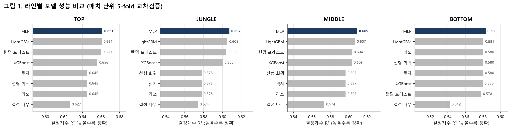
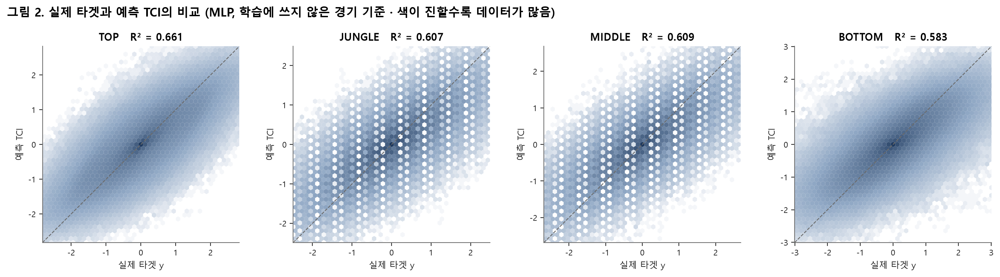
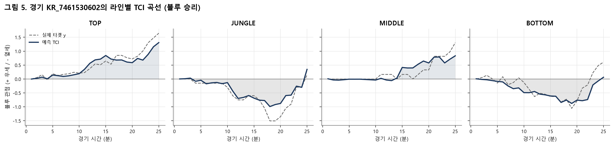

# 리그 오브 레전드 경기력 평가를 위한 설계 및 활용

## 1. 개 요

---

리그 오브 레전드(League of Legends, 이하 LoL)는 아시안게임 정식 종목으로 채택될 만큼 대중성과 파급력이 검증된 게임이다. LoL을 플레이하는 가장 보편적인 방식은 랭크 게임이며, 그중에서도 5대5 솔로랭크 매치가 대표적이다. 솔로랭크 매치는 최대 2명의 소환사가 함께 참여할 수 있고, 플레이의 일차적인 목적은 게임을 숙달하여 랭크를 올리는 데 있다. 프로게이머나 스트리머처럼 최고 수준의 실력을 갖춘 소환사도 솔로랭크를 플레이하며, 이를 실력 향상과 유지를 위한 훈련 수단으로 활용한다[[1]](https://www.dailyesports.com/view.php?ud=2020081809094087763cf949c6b9_27).

솔로랭크는 매 경기 팀원이 무작위로 구성되므로, 경기의 승패는 개인의 실력뿐 아니라 팀원 구성이라는 우연적 요소에 크게 좌우된다. 따라서 솔로랭크 매치를 단순한 승패 예측이나 팀워크 관점에서 분석하는 것은 플레이 목적에 부합하지 않을 가능성이 높다. 그보다는 경기가 진행되는 과정에서 각 소환사가 상대 대비 어느 정도의 우위를 만들어 냈는지를 지표로 나타내는 것이 더 합리적인 분석 목적이 될 것이다. 이에 본 보고서에서는 라인별로 LoL 경기력을 분 단위 과정 지표로 나타내는 모델을 설계하고자 한다.

### 1.1 분석 데이터

LoL 개발사인 Riot Games는 자사의 개발자 포털을 통해 매치 데이터를 API(Application Programming Interface) 방식으로 무료 제공한다[[2]](#참고문헌). 본 연구의 분석 대상은 2025년 1월 8일부터 2025년 4월 7일까지 한국 서버(KR) 챌린저 티어 300명이 플레이한 53,279건의 매치이며, 챌린저 300명은 2025년 4월 8일 기준이다. 경기 초반에 항복으로 끝난 경기는 과정 지표를 충분히 담지 못하므로, 이 중 20분 이상 진행된 경기만을 분석 대상으로 한다.

데이터는 경기 결과와 참가자별 최종 기록을 담은 매치(match) 데이터와, 1분 간격의 참가자 상태(`participantFrames`) 및 경기 중 발생한 사건(`events`)을 담은 타임라인(timeline) 데이터로 구성된다. 제공된 데이터는 30경기 안팎씩 묶인 매치·타임라인 파일 1,075쌍(`match_data` 폴더, 38,075경기)과 표본 파일 1쌍(`match_0.json`, `timeline_0.json`, 30경기)이다. 이를 합친 **38,105경기**를 최종 분석에 사용하였다. 모든 경기가 20분 이상 진행되었고 10명의 포지션이 정상적으로 배정되어 있어, 제외된 경기는 없었다. 경기당 타임라인 프레임은 평균 28.6개(1분 간격)이며, 가장 짧은 경기는 21개, 가장 긴 경기는 56개였다.

방법론은 표본 30경기로 먼저 설계·점검한 뒤, 같은 코드를 전체 38,105경기에 적용하였다. 본문의 모든 수치는 전체 데이터의 결과이다.

### 1.2 경기력 평가를 위한 기본 방향

선행연구[[3]](https://www.kci.go.kr/kciportal/ci/sereArticleSearch/ciSereArtiView.kci?sereArticleSearchBean.artiId=ART003327764)는 동일한 데이터로 미드라이너의 경기력을 분 단위로 평가하였다. 본 연구는 이를 4개 라인(TOP, JUNGLE, MIDDLE, BOTTOM)으로 확장하여, 라인별 타임라인 기여도 지수(Timeline Contribution Index, 이하 TCI)를 설계한다. 여기서 BOTTOM은 봇 듀오를 의미하며, 원거리 딜러(ADC)와 서포터(SPT)를 하나의 단위로 묶어 설계한다. 데이터상으로는 `teamPosition` 값이 `BOTTOM`인 참가자를 ADC로, `UTILITY`인 참가자를 SPT로 구분한다.

라인별 TCI는 지도학습으로 모델링한다. 각 라인에서 중요한 플레이 지표를 입력($\vec{x}$)으로, 그 시점의 경기 우위를 나타내는 값을 출력(타겟 변수 $y$)으로 설정한 뒤, 입력으로 출력을 예측하는 모델을 학습한다. 학습된 모델의 예측값이 곧 해당 라인의 $t$분 시점 TCI가 된다.

$$
TCI_{LANE} (\vec{x}, t ; \theta), ~~~\text{where}~~LANE \in \{ TOP,~JUNGLE,~MIDDLE,~BOTTOM\}
$$

### 1.3 분석 목적

TCI는 경기의 최종 승패와 분리하여, 각 라이너가 경기 중 매 분마다 상대 라이너 대비 얼마나 우위를 만들었는지를 하나의 수치로 보여준다. 이를 통해 팀이 패배한 경기에서도 개인의 기여를 확인할 수 있고, 소환사별로 강점을 보이는 시간대(초반, 중반, 후반)를 파악할 수 있다. 또한 챌린저와 비챌린저 소환사의 TCI 분포를 비교하여 TCI가 실력을 구분하는 지표로 기능하는지 검증한다. 구체적인 활용 방안은 4장에서 기술한다.

---

## 2. 변수 설정

---

### 2.1 타겟 변수 설정

TCI를 지도학습으로 모델링하려면 경기력을 대변하는 출력값, 즉 타겟 변수($y$)가 필요하다. 본 연구는 라인마다 역할이 다르다는 점을 반영하여, 라인별로 서로 다른 지표 조합을 타겟으로 정의하였다. 타겟은 도메인 지식을 바탕으로 먼저 정의한 뒤, 38,105경기에 적용하여 실제 승패를 얼마나 맞히는지로 타당성을 검증하였다.

#### 2.1.1 타겟 변수의 정의

모든 타겟 지표는 같은 라인의 상대와 비교한 **누적 격차**로 계산한다. 즉, $t$분까지 누적된 값에서 블루 팀 값과 레드 팀 값의 차이(블루 − 레드)를 구하며, 레드 팀 관점의 값은 부호만 반대가 된다. BOTTOM은 ADC와 SPT의 값을 합산하여 듀오 단위로 계산한다.

| 라인 | 타겟 구성 지표 | 설정 이유 |
|---|---|---|
| TOP | 경험치 격차 + 포탑 골드 격차 | 탑은 다른 라인과 떨어져 1:1 라인전을 길게 치르므로 레벨(경험치) 우위가 곧 라인 주도권이다. 또한 라인 우위는 포탑 방패와 포탑 파괴라는 구조물 이득으로 이어진다. |
| JUNGLE | 킬 격차 + 어시스트 격차 | 정글러의 핵심 역할은 갱킹과 교전 개입으로 다른 라인에 우위를 만들어 주는 것이므로, 킬과 어시스트를 통한 교전 관여를 경기력으로 본다. |
| MIDDLE | 킬 격차 + 어시스트 격차 | 미드는 맵 중앙에서 양쪽 라인과 정글로의 로밍이 잦아, 자신의 라인뿐 아니라 맵 전체 교전에 얼마나 관여했는지가 중요하다. |
| BOTTOM | 미니언 격차 + 골드 격차 | ADC는 미니언 처치로 골드를 모아 성장하는 것이 핵심이며, 바텀 듀오의 우위는 결국 ADC의 성장 격차로 나타난다. 미니언은 라인전에서의 파밍 능력을, 골드는 킬·포탑 등을 포함한 전체 성장을 반영한다. |

포탑 골드는 Riot 타임라인 데이터에 선수별 값이 따로 기록되지 않으므로 이벤트로 근사하였다. TOP 라인(`laneType = TOP_LANE`)에서 발생한 포탑 방패 파괴(`TURRET_PLATE_DESTROYED`)는 1개당 125골드, 포탑 파괴(`BUILDING_KILL`, `TOWER_BUILDING`)는 1개당 250골드로 환산하였다. 방패는 미니언이 마무리하는 경우(`killerId = 0`)가 약 절반을 차지하므로, 선수가 아닌 TOP 라인을 민 팀에 귀속하였다.

초기 설계에서는 서포터의 시야 기여를 반영하기 위해 BOTTOM 타겟에 와드 설치 격차를 포함하였다. 그러나 와드 설치 격차는 단독으로 경기 종료 시점 승패를 57.4%만 맞혀 우연(50%)과 큰 차이가 없었고, 결합 타겟의 정확도를 떨어뜨렸다. 와드 설치량은 경기 우위보다 서포터 개인의 플레이 습관에 크게 좌우되기 때문으로 판단하여, 최종 타겟에서는 제외하였다.

#### 2.1.2 정규화

두 개 이상의 지표를 합칠 때 원시값을 그대로 더하면, 골드(수천 단위)처럼 값의 크기가 큰 지표가 킬(한 자릿수)처럼 작은 지표를 압도하여 정보가 손실된다. 이를 막기 위해 각 지표를 라인별 표준편차 $\sigma_k$로 나누어 같은 척도로 맞춘 뒤 평균하였다.

$$
y_{LANE,\,t} = \frac{1}{K} \sum_{k=1}^{K} \frac{\Delta_{k,t}}{\sigma_k}
$$

여기서 $\Delta_{k,t}$는 $t$분 시점 $k$번째 지표의 격차, $K$는 해당 라인의 지표 개수이다. 일반적인 z-점수와 달리 평균을 빼지 않았는데, 이는 $y=0$이 "상대와 대등함"을 의미하도록 하고 레드 팀 관점의 값이 정확히 $-y$가 되는 대칭성을 유지하기 위해서이다. 표준편차는 38,105경기의 전체 분 단위 값(블루 관점)으로 계산하였으며 그 값은 다음과 같다.

| 라인 | 지표별 표준편차 $\sigma_k$ |
|---|---|
| TOP | 경험치 1504.41, 포탑 골드 395.67 |
| JUNGLE | 킬 3.33, 어시스트 3.30 |
| MIDDLE | 킬 3.04, 어시스트 3.07 |
| BOTTOM | 미니언 23.58, 골드 2102.89 |

#### 2.1.3 타겟 변수의 검증

정의한 타겟이 실제 경기 우위를 반영하는지 확인하기 위해, $y$의 부호로 승패를 예측하였다. 블루 관점 $y>0$이면 블루 승리로 예측하고, $y=0$(대등)인 경기는 판정에서 제외하였다. 라인 단위와 함께, 4개 라인의 $y$를 합한 팀 단위도 확인하였다.

**표 1. 타겟 $y$의 승패 예측 정확도 (38,105경기)**

| 단위 | 5분 | 10분 | 15분 | 20분 | 경기 종료 |
|---|---|---|---|---|---|
| TOP | 0.528 | 0.556 | 0.591 | 0.640 | 0.824 |
| JUNGLE | 0.565 | 0.591 | 0.626 | 0.691 | **0.868** |
| MIDDLE | 0.554 | 0.575 | 0.608 | 0.664 | 0.844 |
| BOTTOM | 0.543 | 0.562 | 0.592 | 0.637 | 0.748 |
| TEAM (4개 라인 합) | 0.575 | 0.624 | 0.684 | 0.758 | **0.956** |

**표 2. 타겟 구성 지표별 경기 종료 시점 승패 예측 정확도**

| 라인 | 지표별 정확도 | 결합 타겟 |
|---|---|---|
| TOP | 경험치 0.841, 포탑 골드 0.714 | 0.824 |
| JUNGLE | 킬 0.742, 어시스트 0.817 | 0.868 |
| MIDDLE | 킬 0.722, 어시스트 0.815 | 0.844 |
| BOTTOM | 미니언 0.573, 골드 0.853 | 0.748 |

4개 라인의 타겟을 합친 팀 단위 값은 경기 종료 시점에 **95.6%**의 경기에서 승패를 맞혔다. 이는 라인별로 정의한 타겟이 경기의 전체적인 우위를 잘 설명한다는 근거가 된다. 라인 단위로도 경기 종료 시점에 74.8~86.8%의 정확도를 보였다. 그중 JUNGLE의 킬·어시스트 격차가 86.8%로 가장 높았는데, 정글러의 교전 관여가 경기 결과와 가장 밀접함을 보여준다.

JUNGLE과 MIDDLE에서는 킬과 어시스트를 하나로 합친 결합 타겟(86.8%, 84.4%)이 각 지표 단독(킬 74.2%·72.2%, 어시스트 81.7%·81.5%)보다 승패를 더 잘 맞혔다. 두 지표를 정규화해 결합한 것이 정보를 보완한다는 의미이다. 또한 두 라인 모두 어시스트가 킬보다 승패를 더 잘 맞혔는데, 혼자 킬을 따내는 것보다 팀 교전에 폭넓게 관여하는 것이 승리와 더 밀접함을 시사한다.

정확도는 경기가 진행될수록 꾸준히 높아졌다. 팀 단위로 5분 57.5%에서 15분 68.4%, 20분 75.8%로 올랐다. 반면 경기 초반(5~10분)의 라인 단위 정확도는 53~59% 수준에 그쳤다. 이는 타겟의 결함이라기보다, 한 라인의 초반 우위만으로 5대5 경기의 최종 결과가 결정되지 않는다는 점을 보여준다. TCI는 승패를 예측하는 지표가 아니라 과정상의 우위를 측정하는 지표이므로, 초반 정확도가 낮은 것은 1장에서 밝힌 분석 목적과도 부합한다.

TOP과 BOTTOM의 결합 타겟은 가장 강한 단일 지표(경험치 84.1%, 골드 85.3%)보다 정확도가 조금 낮았다. 함께 넣은 포탑 골드(71.4%)와 미니언(57.3%)이 승패와 상대적으로 약하게 연결되기 때문이다. 그럼에도 두 지표를 포함한 것은, TCI가 승패를 맞히는 것이 아니라 라인의 역할 수행을 평가하는 지표이기 때문이다. 골드 하나만 쓰면 킬이나 팀 단위 보상으로 얻은 골드까지 섞여, 탑의 구조물 압박이나 ADC의 라인 파밍처럼 라이너 본연의 역할이 잘 드러나지 않는다. 다만 이 판단에는 기준이 필요하므로, 승패와 거의 무관했던 와드 설치(57.4%)는 앞서 밝힌 대로 제외하고, 라인의 핵심 역할을 직접 나타내는 포탑 골드와 미니언만 남겼다.

**한계.** 포탑 골드는 고정 골드 값으로 근사한 값이므로 실제 패치별 보상과 차이가 있을 수 있다.

### 2.2 라인별 피처 설정

피처는 2.1절의 타겟($y$)을 예측하기 위한 입력값으로, 1.2절 수식의 $\vec{x}$에 해당한다. 본 절에서는 피처의 추출 방식을 먼저 통일한 뒤, 라인별 역할에 대한 도메인 지식을 바탕으로 피처를 선정하고, 선정한 피처가 타겟과 실제로 관련이 있는지 데이터로 확인하였다.

#### 2.2.1 피처 추출 방식의 통일

제공된 `data_process_sample.py`는 피처를 추출하는 방식으로 누적(cumulative), 격차(difference), 시점(delta)의 세 가지와 이벤트 집계 예시를 제시하고, 이를 섞지 말고 하나로 통일할 것을 제안한다. 본 연구는 모든 피처를 **누적 격차**, 즉 $t$분까지 누적된 값의 블루 − 레드 차이로 통일하였다. 레드 관점의 값은 부호만 반대가 된다. 데스, 솔로킬, 와드, 방패처럼 이벤트(`events`)에서 얻는 지표도 분마다 횟수를 누적한 뒤 격차를 구하였다. 따라서 값을 가져오는 곳은 프레임과 이벤트로 다르지만, 계산 방식은 모두 같다.

누적 격차를 선택한 이유는 세 가지이다. 첫째, 같은 라인의 상대와 직접 비교하므로 챔피언 특성이나 경기 속도에 따른 절대값 차이가 상쇄되어 "상대보다 얼마나 앞서는가"만 남는다. 둘째, 2.1절의 타겟이 누적 격차로 정의되어 있으므로 입력과 출력이 같은 축을 공유하여 관계를 해석하기 쉽다. 셋째, 시점(delta) 방식은 1분 단위 변화량이라 값의 변동이 크고 0이 많은 반면, 누적 값은 경기 흐름이 쌓인 결과를 안정적으로 담는다.

#### 2.2.2 피처 선정 원칙

피처는 다음 세 가지 원칙에 따라 선정하였다.

1. **타겟 지표는 같은 라인의 피처로 쓰지 않는다.** 타겟이 입력에 포함되면 모델이 플레이와 우위의 관계를 학습하지 않고 정답을 그대로 옮겨 적게 된다(자기 참조). 예를 들어 TOP은 경험치와 포탑·방패를, BOTTOM은 미니언·골드를 피처에서 제외하였다.
2. **타겟의 결과를 담은 지표도 쓰지 않는다.** JUNGLE과 MIDDLE의 타겟은 킬과 어시스트인데, 골드와 경험치에는 킬·어시스트 보상이 포함되어 있다. 이를 피처로 쓰면 타겟 정보가 간접적으로 새어 들어가므로 두 라인에서는 골드와 경험치를 제외하였다.
3. **타겟을 만들어내는 원인이 되는 플레이 지표는 사용한다.** TCI는 "어떤 플레이가 얼마만큼의 우위를 만들었는가"를 학습하는 모델이므로, 원인에 해당하는 지표는 입력으로 적합하다. 예를 들어 BOTTOM의 킬관여는 골드를 버는 원인이므로 피처로 사용하였다.

#### 2.2.3 라인별 피처

**표 3. 라인별 피처와 선정 근거**

| 라인 | 피처 (모두 누적 격차) | 데이터 출처 | 선정 근거 |
|---|---|---|---|
| **TOP** | 미니언 처치 | `minionsKilled` | 탑은 고립된 라인에서 오래 라인전을 하므로 미니언을 안정적으로 처치하는 능력이 경험치 우위의 기반이다. |
| | 챔피언에게 가한 피해 | `totalDamageDoneToChampions` | 1:1 견제와 교전에서 상대를 얼마나 압박했는지를 나타낸다. |
| | 받은 피해 | `totalDamageTaken` | 상대에게 견제당한 정도로, 많이 맞을수록 라인을 비우거나 미니언을 놓치게 된다. |
| | 솔로킬 | `CHAMPION_KILL` (어시스트 없이 맞라이너 처치) | 탑은 정글 개입이 적은 라인이라 1:1 처치가 라인전 우열을 가장 직접적으로 보여준다. |
| | 데스 | `CHAMPION_KILL`의 `victimId` | 죽으면 부활 시간 동안 경험치와 포탑을 잃으므로 타겟과 반대 방향으로 작용한다. |
| **JUNGLE** | 정글 몬스터 처치 | `jungleMinionsKilled` | 정글러의 기본 성장 수단으로, 동선 효율과 갱킹 타이밍 확보의 기반이다. |
| | 에픽 몬스터 처치 | `ELITE_MONSTER_KILL` (드래곤, 전령, 공허 유충, 바론, 아타칸), 팀 기준 | 강타를 가진 정글러가 주도하는 오브젝트로, 교전을 유도하고 팀 전체에 이득을 준다. |
| | 데스 | `CHAMPION_KILL`의 `victimId` | 갱킹 실패나 카정 손해를 나타내며, 정글러가 죽으면 맵 장악과 교전 개입이 끊긴다. |
| | 와드 설치 | `WARD_PLACED`의 `creatorId` (`UNDEFINED` 제외) | 시야 확보는 갱킹 경로와 상대 정글 동선을 파악하는 전제 조건이다. |
| | 챔피언에게 가한 피해 | `totalDamageDoneToChampions` | 갱킹과 교전에서 실제로 얼마나 기여했는지를 나타낸다. |
| **MIDDLE** | 미니언 처치 | `minionsKilled` | 라인을 먼저 정리해야 로밍과 교전 합류가 가능하므로 라인 관리 능력을 나타낸다. |
| | 챔피언에게 가한 피해 | `totalDamageDoneToChampions` | 미드는 주로 딜러 챔피언이 맡아 교전에서 피해를 넣는 역할이 크다. |
| | 받은 피해 | `totalDamageTaken` | 상대에게 견제당한 정도로, 라인 주도권을 잃었음을 나타낸다. |
| | 데스 | `CHAMPION_KILL`의 `victimId` | 미드가 죽으면 양쪽 라인과 정글에 대한 개입이 모두 끊긴다. |
| | 방패 파괴 | `TURRET_PLATE_DESTROYED` (`MID_LANE`), 팀 기준 | 라인 주도권을 구조물 이득으로 바꾼 결과로, 로밍 여유를 만든다. |
| | 로밍 시간 | `participantFrames`의 `position` (매 분 위치) | 미드 타겟을 킬·어시스트로 정한 근거가 로밍이므로, 로밍을 직접 측정하는 피처를 둔다. 미드 라인은 맵의 대각선($x=y$) 위에 있으므로, 매 분 위치가 이 선에서 1,500 이상 떨어져 있으면 로밍 중인 것으로 보고 그 분 수를 누적한다. |
| **BOTTOM** | ADC 챔피언에게 가한 피해 | ADC의 `totalDamageDoneToChampions` | ADC의 본래 역할은 교전에서 지속적으로 피해를 넣는 것이다. |
| | 듀오 킬관여 | `CHAMPION_KILL` (듀오 중 한 명 이상이 킬·어시스트) | 2:2 교전 승리는 골드를 버는 핵심 원인이다. |
| | 듀오 데스 | `CHAMPION_KILL`의 `victimId` (듀오 합) | 죽으면 미니언과 골드를 잃으므로 타겟과 반대 방향으로 작용한다. |
| | 듀오 와드 제거 | `WARD_KILL`의 `killerId` | 상대 시야를 지우는 것은 서포터의 시야 싸움 기여로, 상대의 갱킹과 오브젝트 시도를 어렵게 만든다. |
| | 방패 파괴 | `TURRET_PLATE_DESTROYED` (`BOT_LANE`), 팀 기준 | 라인 우위를 구조물 골드로 바꾼 결과이다. |

에픽 몬스터와 방패 파괴는 이벤트에 처치자가 기록되지 않거나(방패의 약 절반은 미니언이 마무리) 정글러 외 팀원이 마무리하는 경우가 있어, 선수가 아닌 팀 기준으로 집계하였다. 로밍 시간의 기준 거리 1,500은 표본 30경기에서 3~13분 미드라이너의 위치를 확인하여 정하였다. 미드라이너는 라인 중심선에서 절반이 약 300 이내, 4분의 3이 약 800 이내에 있었으므로, 1,500 이상은 라인을 확실히 벗어난 것으로 볼 수 있다. 단, 위치는 1분에 한 번만 기록되므로 1분보다 짧은 로밍은 놓칠 수 있다.

#### 2.2.4 피처 점검

선정한 피처가 타겟과 실제로 관련이 있는지 확인하기 위해, 38,105경기의 전체 분 단위 값(0분 제외)으로 각 피처와 타겟 $y$의 피어슨 상관계수를 계산하였다.

**표 4. 피처와 타겟 $y$의 상관계수 (38,105경기)**

| 라인 | 피처별 상관계수 |
|---|---|
| TOP | 미니언 +0.64, 가한 피해 +0.50, 받은 피해 −0.12, 솔로킬 +0.52, 데스 −0.65 |
| JUNGLE | 정글 몬스터 +0.24, 에픽 몬스터 +0.32, 데스 −0.62, 와드 설치 +0.06, 가한 피해 +0.58 |
| MIDDLE | 미니언 +0.08, 가한 피해 +0.56, 받은 피해 −0.21, 데스 −0.64, 방패 파괴 +0.17, 로밍 시간 +0.02 |
| BOTTOM | ADC 가한 피해 +0.57, 듀오 킬관여 +0.50, 듀오 데스 −0.57, 듀오 와드 제거 +0.26, 방패 파괴 +0.57 |

모든 피처의 상관 방향은 도메인 지식으로 예상한 방향과 일치하였다. 가한 피해, 미니언, 솔로킬, 킬관여, 방패처럼 우위를 만드는 지표는 양(+)의 상관을, 데스와 받은 피해처럼 손해를 나타내는 지표는 음(−)의 상관을 보였다. 4개 라인 모두에서 데스가 가장 강한 음의 상관(−0.57~−0.65)을 보였다. 죽으면 부활 시간 동안 경험치, 미니언, 교전 기회를 모두 잃기 때문이다. TOP에서는 미니언(+0.64)과 솔로킬(+0.52)이 경험치 중심의 타겟과 강하게 연결되어, 1:1 라인전 능력이 탑 경기력의 핵심임을 확인하였다.

상관이 약한 피처도 있었다. JUNGLE의 와드 설치(+0.06)와 BOTTOM의 듀오 와드 제거(+0.26)는 타겟과의 선형 관계가 약했다. 시야 장악은 다른 플레이를 가능하게 하는 간접적인 기여이기 때문이다. MIDDLE의 미니언(+0.08)도 상관이 약했는데, 미드는 미니언을 처치하기보다 라인을 정리하고 로밍하는 플레이가 킬·어시스트로 이어지기 때문으로 해석된다. 이 피처들은 3장의 모델링에서 다른 피처와의 결합 효과를 학습할 수 있도록 유지하고, 피처 중요도로 기여 여부를 다시 확인한다. 피처 사이의 상관계수는 모두 절댓값 0.8 미만으로, 같은 정보를 중복으로 담은 피처는 없었다.

**로밍 시간.** 미드의 로밍 시간은 타겟과의 상관이 +0.02로 거의 없었다. 로밍을 많이 다닌다고 해서 킬·어시스트가 저절로 생기지는 않는다는 뜻이다. 반면 가한 피해(+0.56)와 데스(−0.64)는 강하게 연결되었으므로, 미드의 킬·어시스트를 결정하는 것은 로밍의 양이 아니라 **로밍과 교전에서 피해를 넣으면서 살아남는 성과**라고 해석할 수 있다. 이는 미드 타겟을 킬·어시스트로 정한 논리(교전 관여)를 데이터로 한 단계 구체화한 결과이다.

**데스 피처와 킬 타겟의 관계.** JUNGLE과 MIDDLE은 타겟이 킬이고 피처에 데스가 있어, 두 정보가 겹칠 수 있다. 예를 들어 블루 미드가 레드 미드를 처치하면 블루의 킬(타겟)과 레드의 데스(피처)가 동시에 오른다. 이 겹침이 얼마나 되는지 확인하기 위해, 정글러와 미드라이너가 당한 데스 중 상대 같은 라인에게 당한 데스의 비율을 38,105경기 전체로 계산하였다.

| 라인 | 전체 데스 | 상대 같은 라인에게 당한 데스 | 비율 |
|---|---|---|---|
| JUNGLE | 394,679 | 116,357 | 29.5% |
| MIDDLE | 401,809 | 131,954 | 32.8% |

상대 같은 라인에게 당한 데스는 약 30%에 그쳤고, 나머지 약 70%는 다른 라인이나 정글러에게 당한 데스였다. 따라서 데스 피처는 킬 타겟의 복사본이 아니라, 맵 전체에서 살아남는 능력이라는 별도의 정보를 담고 있다고 판단하여 피처로 유지하였다.

---

## 3. 경기력 지표 모델링

---

### 3.1 모델 선정

#### 3.1.1 문제 정의

TCI 모델의 입력은 $t$분 시점 라인별 누적 격차 피처(TOP·JUNGLE·BOTTOM 5개, MIDDLE 6개)와 경과 시간 $t$이다. 출력은 2.1절에서 정의한 연속값 타겟 $y_t$이다. 출력이 연속값이므로 TCI 모델링은 회귀 문제가 된다. 학습 데이터는 (매치, 라인, 진영, 분) 하나를 한 행으로 구성하였다. 0분(모든 값이 0)과 마지막 프레임(1분 미만의 잔여 구간)은 제외하였다. 블루 관점과 레드 관점의 행을 모두 사용하여 라인당 2,103,400개, 전체 8,413,600개의 학습 행을 얻었다.

$$
\hat{y}_t = TCI_{LANE}(\vec{x}_t, t;\theta), \qquad \mathcal{L}(\theta) = \frac{1}{N}\sum_{i=1}^{N}\left(y_i - \hat{y}_i\right)^2
$$

손실 함수는 예측값과 실제 타겟의 차이를 제곱해 평균한 평균제곱오차(MSE)로 설정하였다.

#### 3.1.2 비교 모델

선형 모델부터 신경망까지 성격이 다른 8개 모델을 비교하였다. 각 모델의 주요 설정값은 3.1.4절의 하이퍼파라미터 튜닝으로 정하였으며, 아래 표의 "튜닝 결과"는 라인별로 선택된 값이다. 학습 행이 라인당 200만 개가 넘으므로, 학습 시간이 긴 랜덤 포레스트는 나무마다 10% 표본으로 학습하고 MLP는 1,024행 단위의 미니배치로 학습하도록 설정하였다.

| 계열 | 모델 | 고정 설정 | 튜닝 결과 (TOP / JUNGLE / MIDDLE / BOTTOM) |
|---|---|---|---|
| 선형 | 선형 회귀 (Linear Regression) | 표준화 후 최소제곱법 | 튜닝 대상 없음 |
| 선형 | 릿지 (Ridge) | 표준화 | $\alpha$ = 100 / 100 / 100 / 100 |
| 선형 | 라쏘 (Lasso) | 표준화 | $\alpha$ = 0.0001 / 0.001 / 0.0001 / 0.0001 |
| 트리 | 결정 나무 (Decision Tree) | 잎 노드 최소 20행 | 최대 깊이 = 8 / 8 / 10 / 8 |
| 트리 | 랜덤 포레스트 (Random Forest) | 나무 100개, 나무당 10% 표본, 잎 노드 최소 20행 | 최대 깊이 = 16 / 16 / 16 / 16 |
| 부스팅 | XGBoost | 나무 300개, 행·피처 80% 표본 | 깊이 3, 학습률 0.05 (4개 라인 동일) |
| 부스팅 | LightGBM | 나무 300개, 행·피처 80% 표본 | 잎 15개, 학습률 0.05 (4개 라인 동일) |
| 신경망 | 다층 퍼셉트론 (MLP) | 미니배치 1,024, Adam, 조기 종료 | 은닉층 (16), $\alpha$ = 0.001 / 0.001 / 0.001 / 0.0001 |

#### 3.1.3 비교 모델의 방법론

최종 모델인 MLP는 3.1.5절에서 상세히 설명하고, 여기서는 비교에 사용한 나머지 모델의 작동 원리를 정리한다. 이하 $N$은 학습 행의 수, $\mathbf{x}_i$는 $i$번째 행의 입력(피처 5개와 시간 $t$), $y_i$는 타겟이다.

**(1) 선형 회귀 (Linear Regression)**

입력의 가중합 $\hat{y}_i = \mathbf{w}^\top\mathbf{x}_i + b$로 출력을 예측하며, 오차제곱합 $\sum_i (y_i - \hat{y}_i)^2$을 최소화하는 가중치를 최소제곱법으로 구한다. 나머지 모델의 비교 기준이 되는 기본 모델이다.

**(2) 릿지 회귀 (Ridge Regression)** [[7]](#참고문헌)

선형 회귀의 손실에 가중치 제곱합(L2 규제)을 더한다.

$$
\min_{\mathbf{w},\,b}\; \sum_{i=1}^{N}\left(y_i - \mathbf{w}^\top\tilde{\mathbf{x}}_i - b\right)^2 + \alpha\sum_{j=1}^{p} w_j^2
$$

$\tilde{\mathbf{x}}$는 표준화한 입력, $\alpha$는 규제 강도(튜닝 결과 $\alpha=100$)이다. 규제항은 가중치가 커질수록 벌점을 주므로, 모든 가중치가 0 쪽으로 고르게 줄어든다(shrinkage). 해는 $\mathbf{w}=(X^\top X+\alpha I)^{-1}X^\top\mathbf{y}$로 바로 계산된다. 피처끼리 상관이 높을 때(다중공선성) 선형 회귀는 가중치가 불안정하게 커지거나 부호가 뒤바뀌기 쉬운데, $\alpha I$를 더하면 역행렬 계산이 안정되어 이 문제가 완화된다. 단, 가중치를 정확히 0으로 만들지는 않으므로 모든 피처가 모델에 남는다.

**(3) 라쏘 회귀 (Lasso Regression)** [[6]](#참고문헌)

선형 회귀의 손실에 가중치 절댓값의 합(L1 규제)을 더한다.

$$
\min_{\mathbf{w},\,b}\; \frac{1}{2N}\sum_{i=1}^{N}\left(y_i - \mathbf{w}^\top\tilde{\mathbf{x}}_i - b\right)^2 + \alpha\sum_{j=1}^{p} |w_j|
$$

규제 강도는 라인별로 튜닝하였다($\alpha=0.0001$~$0.001$). 릿지와 달리 L1 규제는 기여가 작은 피처의 가중치를 **정확히 0**으로 만든다. 가중치 하나에 대해 손실을 최소화하는 값을 구하면, 그 피처의 설명력이 $\alpha$보다 작을 때 0이 되기 때문이다(soft-thresholding). 그래서 라쏘는 학습과 동시에 피처 선택을 수행한다. 해는 좌표 하강법(coordinate descent)으로 구하는데, 다른 가중치를 고정한 채 가중치 하나씩 최적값으로 갱신하는 과정을 수렴할 때까지 반복한다. 실제로 라쏘는 모든 라인에서 시간($t$)의 가중치를 0으로 만들었다(3.2.2절 표 8).

**(4) 결정 나무 (Decision Tree)**

입력 공간을 "미니언 격차 ≤ 12.5인가?"처럼 피처 하나와 기준값으로 반복해서 둘로 나누어, 나무 모양의 규칙을 만든다. 각 분할에서는 나뉜 두 그룹의 오차제곱합이 가장 작아지는 피처와 기준값을 고른다.

$$
\min_{j,\,s}\; \left[\sum_{i \in L(j,s)} (y_i - \bar{y}_L)^2 + \sum_{i \in R(j,s)} (y_i - \bar{y}_R)^2\right]
$$

$L$과 $R$은 피처 $j$가 기준값 $s$ 이하·초과인 그룹이고, $\bar{y}_L$, $\bar{y}_R$은 각 그룹의 타겟 평균이다. 더 나눌 수 없을 때(최대 깊이 8~10, 잎 노드 최소 20행) 분할을 멈추고, 각 잎 노드의 타겟 평균을 예측값으로 사용한다. 규칙을 그대로 읽을 수 있어 해석이 쉽지만, 연속적인 관계를 계단 모양으로만 근사하고 학습 데이터에 과적합되기 쉽다.

**(5) 랜덤 포레스트 (Random Forest)** [[8]](#참고문헌)

결정 나무 여러 개를 독립적으로 학습해 그 예측을 평균하는 앙상블 모델이다.

$$
\hat{y} = \frac{1}{B}\sum_{b=1}^{B} f_b(\mathbf{x})
$$

각 나무 $f_b$는 학습 데이터에서 복원 추출한 서로 다른 표본(부트스트랩)으로 학습한다(배깅, bagging). 본 연구는 데이터가 커서 나무마다 학습 행의 10%만 뽑아 사용하였다. 나무들이 서로 다른 데이터를 보고 학습하므로 개별 나무의 오차가 평균되면서 상쇄되어, 단일 결정 나무보다 과적합이 줄고 예측이 안정된다. 나무 100개($B=100$), 최대 깊이 16, 잎 노드 최소 20행으로 설정하였다.

**(6) 그래디언트 부스팅: XGBoost와 LightGBM**

랜덤 포레스트가 나무를 **독립적으로 병렬** 학습하는 반면, 부스팅은 나무를 **순차적으로** 학습한다. 새 나무는 이전 나무들이 틀린 부분을 보완하도록 학습된다.

$$
F_m(\mathbf{x}) = F_{m-1}(\mathbf{x}) + \eta\, f_m(\mathbf{x}), \qquad m = 1, \dots, M
$$

$F_{m-1}$은 지금까지 만든 나무들의 합, $f_m$은 새로 추가하는 나무, $\eta$는 학습률(0.05)이다. 새 나무 $f_m$은 손실 함수의 기울기 방향, 즉 현재 예측이 정답에서 벗어난 방향을 학습한다. 손실이 MSE이면 이 방향은 잔차 $y_i - F_{m-1}(\mathbf{x}_i)$와 같다. 학습률을 작게 하여 나무 하나하나의 영향은 줄이고, 대신 나무를 많이(300개) 쌓아 오차를 조금씩 줄여 나간다.

*XGBoost* [[9]](#참고문헌)는 이 기본 원리에 두 가지를 더했다. 첫째, 손실에 나무의 복잡도에 대한 규제항을 추가한다.

$$
\mathcal{L} = \sum_{i=1}^{N} l\left(y_i, \hat{y}_i\right) + \sum_{m}\Omega(f_m), \qquad \Omega(f) = \gamma T + \frac{1}{2}\lambda \sum_{j=1}^{T} w_j^2
$$

$T$는 잎 노드 개수, $w_j$는 잎 노드 $j$의 예측값이다. 잎이 많거나 잎의 값이 클수록 벌점을 주어 과적합을 막는다. 둘째, 손실을 2차 테일러 전개로 근사하여 1차 미분 $g_i$와 2차 미분 $h_i$를 함께 사용한다. MSE 손실에서는 $g_i = \hat{y}_i - y_i$, $h_i = 1$이다. 이 근사를 이용하면 잎 노드 $j$에 속한 행들의 $G_j=\sum g_i$, $H_j=\sum h_i$로 최적의 잎 값과 분할 이득을 바로 계산할 수 있다.

$$
w_j^* = -\frac{G_j}{H_j + \lambda}, \qquad
\text{Gain} = \frac{1}{2}\left[\frac{G_L^2}{H_L+\lambda} + \frac{G_R^2}{H_R+\lambda} - \frac{(G_L+G_R)^2}{H_L+H_R+\lambda}\right] - \gamma
$$

분할 이득(Gain)이 가장 큰 기준으로 나무를 나누고, 이득이 0보다 작으면 나누지 않는다. 나무는 같은 깊이의 노드를 한 층씩 차례로 나누는 깊이 우선(level-wise) 방식으로 키운다. 튜닝 결과 깊이 3, 학습률 0.05가 선택되었고 $\lambda=1$로 설정하였으며, 나무마다 행의 80%와 피처의 80%를 무작위로 사용하여 과적합을 줄였다. 또한 피처 값을 구간으로 묶어 분할 후보를 줄이는 히스토그램 방식(`tree_method="hist"`)으로 학습 속도를 높였다.

*LightGBM* [[10]](#참고문헌)은 같은 그래디언트 부스팅을 대용량 데이터에서 더 빠르게 학습하도록 설계된 모델이다. 두 가지 차이가 핵심이다.

- **히스토그램 기반 분할:** 연속 피처 값을 최대 255개 구간으로 미리 묶어 두고, 분할 기준을 모든 값이 아니라 구간 경계에서만 찾는다. 200만 행의 모든 값을 정렬하지 않아도 되므로 계산량과 메모리가 크게 줄어든다.
- **잎 단위 성장 (leaf-wise):** XGBoost처럼 한 층을 통째로 나누지 않고, 현재 모든 잎 중 손실을 가장 많이 줄이는 잎 하나만 골라 나눈다. 같은 잎 개수로 더 낮은 손실에 도달하지만, 나무가 한쪽으로 깊어져 과적합되기 쉬우므로 잎 개수를 제한한다.

튜닝 결과 잎 15개, 학습률 0.05가 선택되었고, 잎 노드 최소 20행으로 나무 크기를 제한하였으며, 나무마다 행과 피처의 80%만 사용하였다. LightGBM 논문은 기울기가 큰 행을 우선 표본추출하는 GOSS와 피처 묶음 기법인 EFB도 제안하였으나, 본 연구는 기본 그래디언트 부스팅 방식을 사용하였다.

#### 3.1.4 하이퍼파라미터 튜닝과 평가 방법

**하이퍼파라미터 튜닝.** 모델의 성능은 규제 강도, 나무 깊이, 은닉층 구조 같은 설정값(하이퍼파라미터)에 따라 달라진다. 모델마다 성능에 큰 영향을 주는 설정의 후보를 정하고, 라인별로 3,000경기를 무작위로 뽑은 튜닝용 표본에서 매치 단위 3-fold 교차검증으로 RMSE가 가장 낮은 값을 선택하였다.

| 모델 | 튜닝한 설정 | 후보 |
|---|---|---|
| 릿지 | 규제 강도 $\alpha$ | 0.1, 1, 10, 100 |
| 라쏘 | 규제 강도 $\alpha$ | 0.0001, 0.001, 0.01, 0.1 |
| 결정 나무 | 최대 깊이 | 4, 6, 8, 10, 12 |
| 랜덤 포레스트 | 최대 깊이 | 8, 12, 16 |
| XGBoost | 최대 깊이 × 학습률 | {3, 5, 7} × {0.05, 0.1} |
| LightGBM | 잎 개수 × 학습률 | {15, 31, 63} × {0.05, 0.1} |
| MLP | 은닉층 구조 × 규제 강도 $\alpha$ | {(16), (32, 16), (64, 32), (64, 32, 16)} × {0.0001, 0.001} |

선택된 값은 3.1.2절 표와 같다. 부스팅 계열은 가장 단순한 설정(XGBoost 깊이 3, LightGBM 잎 15개)이, MLP는 가장 작은 구조(은닉층 하나, 뉴런 16개)가 모든 라인에서 선택되었다. 피처가 5~6개로 적고 피처와 타겟의 관계가 비교적 단순하여, 복잡한 모델은 오히려 과적합되기 때문이다. MLP의 튜닝 결과는 3.1.5절에 자세히 제시한다.

**평가 방법.** 같은 경기의 데이터가 학습과 평가에 동시에 들어가면, 모델이 그 경기의 흐름을 외워 성능이 부풀려진다. 이를 막기 위해 튜닝된 설정으로 전체 데이터에 **매치 단위 5-fold 교차검증(GroupKFold)**을 수행하였다. 38,105경기를 5개 묶음으로 나누어, 매번 4묶음(약 30,500경기)으로 학습하고 나머지 1묶음(약 7,600경기)으로 평가하는 과정을 5번 반복한다. 이렇게 하면 모든 경기가 한 번씩 "학습에 쓰이지 않은 경기"로 예측된다(out-of-fold 예측). 이 예측값으로 MSE, RMSE, MAE, 결정계수($R^2$)를 계산하였다. 튜닝용 표본(3,000경기)은 전체의 약 8%로, 최종 평가에 미치는 영향은 작다.

#### 3.1.5 최종 모델: 다층 퍼셉트론(MLP)

4개 라인 평균 RMSE가 가장 낮은 **다층 퍼셉트론(Multi-Layer Perceptron, MLP)**을 최종 모델로 선정하였다(3.2절 표 5).

**구조.** MLP는 입력층, 은닉층, 출력층이 차례로 연결된 인공신경망이다. 튜닝 결과 선택된 최종 구조는 은닉층이 하나인 MLP이다.

```
입력층 (6~7)                  은닉층 (16)              출력층 (1)
피처 5~6개 + 시간 t     →     ReLU 뉴런 16개     →     TCI 예측값
```

입력은 TOP·JUNGLE·BOTTOM이 피처 5개와 시간을 합친 6개, MIDDLE이 로밍 시간을 더한 7개이다. 각 뉴런은 이전 층의 모든 출력에 가중치를 곱해 더하고 편향을 더한 뒤, 활성화 함수를 거쳐 다음 층으로 전달한다.

$$
\mathbf{h} = \text{ReLU}\left(W^{(1)}\tilde{\mathbf{x}} + \mathbf{b}^{(1)}\right),\qquad
\hat{y} = \mathbf{w}^{(2)\top}\mathbf{h} + b^{(2)}
$$

여기서 $\tilde{\mathbf{x}}$는 평균 0, 표준편차 1로 표준화한 입력이고, $\text{ReLU}(z)=\max(0, z)$이다. ReLU는 음수를 0으로 잘라내는 단순한 함수지만, 뉴런마다 서로 다른 지점에서 꺾이는 직선을 만들고 출력층이 이들을 더하므로, 전체적으로는 여러 직선을 이어 붙인 곡선(비선형 관계)을 표현할 수 있다. 출력층은 회귀 문제이므로 활성화 함수 없이 값을 그대로 내보낸다. 학습할 파라미터는 입력 6개 기준 129개(6×16+16 + 16×1+1), MIDDLE은 145개이다.

**학습 방법.** 파라미터 $\theta$는 다음 손실을 최소화하도록 학습한다.

$$
\mathcal{L}(\theta) = \frac{1}{2N}\sum_{i=1}^{N}\left(y_i - \hat{y}_i\right)^2 + \frac{\alpha}{2N}\lVert W \rVert_2^2
$$

첫째 항은 MSE이고, 둘째 항은 가중치가 지나치게 커지는 것을 막는 L2 규제이다(튜닝 결과 $\alpha=0.001$, BOTTOM은 $0.0001$). 학습 과정은 다음과 같다.

1. **순전파:** 미니배치(1,024행)를 입력해 예측값을 계산한다.
2. **역전파:** 손실을 각 가중치로 미분한 기울기를 출력층에서 입력층 방향으로 연쇄법칙을 이용해 계산한다.
3. **가중치 갱신:** Adam 최적화 알고리즘으로 가중치를 조정한다. Adam은 기울기의 이동평균과 기울기 제곱의 이동평균을 함께 사용하여, 파라미터마다 학습률을 자동으로 조절한다(초기 학습률 0.001).
4. **조기 종료:** 학습 데이터의 10%를 검증용으로 떼어 두고, 검증 손실이 10회 연속 개선되지 않으면 학습을 멈춘다. 학습 데이터에 과적합되기 전에 멈추기 위한 장치이다.

**구조 선택 (튜닝 결과).** 은닉층 구조 4가지와 규제 강도 2가지의 조합 8개를 비교하였다(튜닝용 3,000경기, 3-fold).

**표 5-1. MLP 구조별 RMSE (튜닝용 표본)**

| 은닉층 구조 | $\alpha$ | TOP | JUNGLE | MIDDLE | BOTTOM |
|---|---|---|---|---|---|
| **(16)** | 0.0001 | **0.5005** | **0.4384** | 0.4399 | **0.5758** |
| **(16)** | 0.001 | **0.5005** | **0.4384** | **0.4398** | 0.5759 |
| (32, 16) | 0.0001 | 0.5068 | 0.4448 | 0.4541 | 0.5882 |
| (32, 16) | 0.001 | 0.5056 | 0.4447 | 0.4524 | 0.5920 |
| (64, 32) | 0.0001 | 0.5158 | 0.4513 | 0.4666 | 0.6037 |
| (64, 32) | 0.001 | 0.5178 | 0.4529 | 0.4659 | 0.6087 |
| (64, 32, 16) | 0.0001 | 0.5238 | 0.4595 | 0.4755 | 0.6176 |
| (64, 32, 16) | 0.001 | 0.5294 | 0.4587 | 0.4690 | 0.6165 |

4개 라인 모두에서 구조가 클수록 오차가 커졌고, 가장 작은 구조(은닉층 하나, 뉴런 16개)가 가장 정확하였다. 입력이 6~7개뿐이고 피처와 타겟의 관계가 대부분 선형에 가깝기 때문에, 층과 뉴런을 늘리면 학습 데이터의 우연한 패턴까지 외우는 과적합이 일어난다. 규제 강도는 결과에 거의 영향이 없었다.

**이 입출력에 적합한 이유.**

1. **시간에 따라 피처의 의미가 달라진다.** 같은 "CS 10개 차이"라도 5분에는 큰 우위지만 30분에는 작은 차이이다. 선형 모델은 피처와 시간을 각각 독립적으로 더하기 때문에 이런 상호작용을 표현하지 못한다. 실제로 라쏘는 시간($t$)의 계수를 0으로 만들었지만, MLP에서는 시간이 TOP과 JUNGLE에서 네 번째, 세 번째로 중요한 피처였다(3.2.2절).
2. **데이터가 충분하다.** 라인당 200만 개가 넘는 학습 행은 130~145개의 파라미터를 안정적으로 추정하기에 충분하다.
3. **출력이 연속값이다.** 회귀 출력층과 MSE 손실로, 정규화된 우위 점수를 직접 예측할 수 있다.

### 3.2 모델링 결과

#### 3.2.1 모델 비교

**표 5. 모델별 RMSE (매치 단위 5-fold 교차검증, 낮을수록 정확)**

| 모델 | TOP | JUNGLE | MIDDLE | BOTTOM | 평균 |
|---|---|---|---|---|---|
| **MLP** | **0.492** | **0.433** | **0.442** | **0.557** | **0.481** |
| LightGBM | 0.493 | 0.434 | 0.443 | 0.558 | 0.482 |
| Random Forest | 0.493 | 0.435 | 0.445 | 0.560 | 0.483 |
| XGBoost | 0.496 | 0.437 | 0.445 | 0.559 | 0.484 |
| Linear Regression | 0.504 | 0.449 | 0.449 | 0.558 | 0.490 |
| Ridge | 0.504 | 0.449 | 0.449 | 0.558 | 0.490 |
| Lasso | 0.504 | 0.449 | 0.449 | 0.558 | 0.490 |
| Decision Tree | 0.517 | 0.451 | 0.461 | 0.583 | 0.503 |

**표 6. 모델별 결정계수 $R^2$ (높을수록 정확)**

| 모델 | TOP | JUNGLE | MIDDLE | BOTTOM | 평균 |
|---|---|---|---|---|---|
| **MLP** | **0.661** | **0.607** | **0.609** | **0.583** | **0.615** |
| LightGBM | 0.661 | 0.605 | 0.607 | 0.581 | 0.613 |
| Random Forest | 0.660 | 0.603 | 0.604 | 0.578 | 0.611 |
| XGBoost | 0.656 | 0.600 | 0.603 | 0.580 | 0.610 |
| Linear Regression | 0.645 | 0.578 | 0.597 | 0.580 | 0.600 |
| Ridge | 0.645 | 0.578 | 0.597 | 0.580 | 0.600 |
| Lasso | 0.645 | 0.578 | 0.597 | 0.580 | 0.600 |
| Decision Tree | 0.627 | 0.574 | 0.574 | 0.542 | 0.579 |



MLP가 평균 RMSE 0.481, 평균 $R^2$ 0.615로 가장 정확하였고, 4개 라인 모두에서 $R^2$가 가장 높았다. MLP는 학습에 쓰지 않은 경기에서도 라인 타겟 분산의 58~66%를 설명하였다. 비선형 관계를 학습할 수 있는 모델(MLP, LightGBM, 랜덤 포레스트, XGBoost)이 평균 RMSE 0.481~0.484로 상위를 차지했고, 선형 계열(0.490)이 그 뒤를 이었다. 단일 결정 나무는 연속적인 누적 값을 계단 모양으로만 근사하기 때문에 가장 낮았다(0.503).

다만 상위 모델 간의 차이는 크지 않았다. MLP와 선형 회귀의 RMSE 차이는 약 2%이다. 이는 피처와 타겟의 관계 대부분이 선형으로 설명되고, 비선형 모델은 시간과의 상호작용 같은 나머지 일부를 추가로 잡아낸다는 뜻이다. 각 라인의 평가 행이 200만 개가 넘으므로, 이 정도의 차이도 우연이 아닌 일관된 성능 차이로 볼 수 있다.

라인별로는 TOP의 설명력이 가장 높았고($R^2=0.661$), 나머지 세 라인은 0.58~0.61로 비슷하였다. 특히 BOTTOM은 타겟에서 와드 설치를 제외하기 전에는 $R^2$가 0.48로 가장 낮았으나, 제외한 뒤 0.58로 크게 높아졌다. 서포터 개인의 습관에 좌우되던 와드 설치량이 빠지면서, 타겟이 플레이 지표로 설명 가능한 성장 우위에 집중되었기 때문이다. 라인마다 타겟의 정규화 척도가 달라 RMSE는 라인 간에 직접 비교하기 어려우므로, 라인 간 비교는 $R^2$를 기준으로 하였다.



#### 3.2.2 최종 모델 해석

MLP는 가중치가 층에 걸쳐 얽혀 있어 선형 모델처럼 계수를 직접 읽을 수 없다. 그래서 **순열 중요도(permutation importance)**로 피처의 기여를 해석하였다. 피처 하나의 값을 무작위로 섞어 그 정보를 지운 뒤, 예측 오차(RMSE)가 얼마나 커지는지를 측정한다. 오차가 많이 커질수록 모델이 그 피처에 크게 의존한다는 뜻이다.

**표 7. MLP의 순열 중요도 (피처 값을 섞었을 때 RMSE 증가량)**

| 라인 | 피처별 중요도 (큰 순서) |
|---|---|
| TOP | 미니언 0.197, 데스 0.193, 가한 피해 0.051, 시간 0.041, 받은 피해 0.018, 솔로킬 0.007 |
| JUNGLE | 가한 피해 0.317, 데스 0.211, 시간 0.046, 정글 몬스터 0.031, 에픽 몬스터 0.007, 와드 설치 0.002 |
| MIDDLE | 데스 0.293, 가한 피해 0.270, 받은 피해 0.059, 미니언 0.048, 시간 0.016, 로밍 시간 0.002, 방패 파괴 0.002 |
| BOTTOM | 방패 파괴 0.144, ADC 가한 피해 0.136, 듀오 데스 0.070, 듀오 와드 제거 0.034, 듀오 킬관여 0.006, 시간 0.005 |


라인별로 TCI를 결정하는 핵심 플레이가 뚜렷이 달랐다.

- **TOP:** 미니언 처치와 데스가 거의 같은 비중으로 가장 중요했다. 미니언을 꾸준히 먹으면서 죽지 않는 것이 탑 경험치 우위의 핵심이라는 2.2절의 근거와 일치한다.
- **JUNGLE·MIDDLE:** 가한 피해와 데스가 압도적이었다. 교전에서 피해를 많이 넣으면서 살아남아야 킬과 어시스트를 쌓을 수 있다는 의미이다. 미드는 받은 피해도 세 번째로 중요해, 라인전에서 견제를 덜 당하는 것도 교전 관여의 바탕이 된다. 미드의 로밍 시간은 중요도가 거의 0이었는데, 이는 2.2.4절의 해석대로 로밍의 양보다 교전의 성과(가한 피해, 생존)가 킬·어시스트를 결정한다는 점을 다시 확인해 준다.
- **BOTTOM:** 방패 파괴와 ADC 가한 피해가 가장 중요했고, 듀오 데스와 와드 제거가 뒤를 이었다. 라인을 밀어 구조물 골드를 얻고 교전에서 딜을 넣는 것이 듀오의 미니언·골드 우위로 이어진다는 의미이다. 상대 와드를 지우는 시야 싸움(0.034)도 바텀에서는 의미 있는 기여를 보였다.

에픽 몬스터(0.007), JUNGLE 와드 설치(0.002), MIDDLE 방패 파괴(0.002)는 중요도가 거의 0이었다. 이 지표들은 즉시 킬이나 골드로 환산되지 않는 간접 기여이거나, 팀 단위로 집계되어 개인 라이너의 우위와 직접 연결되지 않기 때문이다.

경과 시간($t$)은 단독으로는 아무 정보가 없지만(같은 시간에 블루와 레드는 대칭), TOP과 JUNGLE에서 각각 네 번째, 세 번째로 중요한 피처였다. MLP가 시간과 다른 피처의 상호작용, 즉 "같은 격차라도 시점에 따라 우위의 크기가 다르다"는 관계를 학습했음을 보여준다. 이것이 3.2.1절에서 MLP가 선형 모델보다 정확했던 이유이다.

참고로 같은 데이터에 라쏘 회귀를 학습한 표준화 계수는 다음과 같다. 선형 모델이므로 "피처가 1 표준편차 늘 때 TCI 변화량"으로 읽을 수 있어, MLP의 해석을 보완한다.

**표 8. (참고) 라쏘 회귀의 표준화 계수 (38,105경기 전체로 학습)**

| 라인 | 계수 |
|---|---|
| TOP | 데스 −0.361, 미니언 +0.339, 가한 피해 +0.162, 받은 피해 +0.084, 솔로킬 +0.041, 시간 0 |
| JUNGLE | 데스 −0.355, 가한 피해 +0.332, 정글 몬스터 −0.115, 에픽 몬스터 +0.051, 와드 설치 +0.026, 시간 0 |
| MIDDLE | 데스 −0.417, 가한 피해 +0.346, 미니언 −0.162, 받은 피해 +0.113, 로밍 시간 +0.032, 방패 파괴 +0.004, 시간 0 |
| BOTTOM | 방패 파괴 +0.302, ADC 가한 피해 +0.252, 듀오 데스 −0.213, 듀오 와드 제거 +0.142, 듀오 킬관여 +0.058, 시간 0 |

라쏘 계수의 순위는 MLP의 순열 중요도와 대체로 일치하였다. 몇몇 계수는 단독 상관(표 4)과 부호가 반대였는데, 다중 회귀의 계수는 "다른 피처가 같을 때"의 효과이기 때문이다.

- **MIDDLE 미니언(−)·JUNGLE 정글 몬스터(−):** 가한 피해와 데스가 같다면, 미니언이나 정글 몬스터를 더 많이 처치했다는 것은 교전 대신 파밍에 시간을 썼다는 뜻이다. 그만큼 킬·어시스트 타겟은 줄어든다. 파밍과 교전 관여 사이의 트레이드오프를 보여주는 결과이다.
- **TOP·MIDDLE 받은 피해(+):** 데스가 같다면, 피해를 많이 받았다는 것은 죽지 않고 적극적으로 딜교환이나 교전에 참여했다는 뜻으로 해석된다.

---

## 4. TCI 모델의 활용

---

TCI는 3장의 MLP 모델이 예측한 값, 즉 "이 플레이 기록이라면 이 정도의 우위가 기대된다"는 값이다. 활용 분석에는 공정성을 위해 out-of-fold 예측값만 사용하였다. 각 경기의 TCI는 그 경기를 학습에 쓰지 않은 모델이 계산한 값이다.

### 4.1 TCI 곡선: 경기 흐름의 시각화

라인별 TCI를 분 단위로 그리면 한 경기 안에서 각 라인의 우열이 어떻게 변했는지 한눈에 볼 수 있다.



위 경기(KR_7461530602)는 블루 팀이 승리했지만 네 라인의 흐름은 서로 달랐다. TOP은 경기 내내 우위를 꾸준히 넓혔고, MIDDLE은 14분 이후 우위를 잡았다. 반면 JUNGLE은 10분부터 크게 밀리다가 20분 이후에야 회복했고, BOTTOM은 20분까지 열세로 밀리다가 그 이후 빠르게 회복해 근소한 우세로 끝냈다. 승패만 보면 "블루 팀 전원 승리"로 기록되지만, TCI로 보면 탑과 미드가 승리를 이끌고 정글과 바텀은 열세를 버텼다는 해석이 가능하다. 예측 TCI(실선)는 실제 타겟(점선)의 흐름을 잘 따라갔다. 둘이 벌어지는 구간(정글 17~20분, 바텀 21~25분)은 피처로 설명되지 않는 요소, 예를 들어 팀원의 도움이나 다른 라인에서 넘어온 골드가 작용한 구간이다.

### 4.2 TCI와 승패의 관계

**표 9. TCI 부호의 승패 일치율 (블루 관점, out-of-fold)**

| 시점 | TOP | JUNGLE | MIDDLE | BOTTOM | TEAM (4라인 합) |
|---|---|---|---|---|---|
| 10분 | 0.552 | 0.573 | 0.557 | 0.578 | 0.627 |
| 15분 | 0.574 | 0.613 | 0.590 | 0.612 | 0.685 |
| 20분 | 0.599 | 0.665 | 0.634 | 0.650 | 0.753 |
| 종료 직전 | 0.670 | 0.783 | 0.739 | 0.751 | **0.903** |

**표 10. 승리·패배 경기의 소환사 평균 TCI**

| | TOP | JUNGLE | MIDDLE | BOTTOM |
|---|---|---|---|---|
| 승리 | +0.128 | +0.154 | +0.126 | +0.178 |
| 패배 | −0.125 | −0.156 | −0.126 | −0.184 |

4개 라인의 TCI를 합한 팀 TCI는 종료 직전에 **90.3%**의 경기에서 승패와 일치하였다. 실제 골드·경험치·킬 대신 플레이 기록만으로 계산한 TCI도 경기의 전체 우위를 잘 반영한다는 뜻이다. 실제 타겟의 일치율(표 1, 95.6%)보다 조금 낮은 것은 TCI가 피처로 설명되는 부분만 담기 때문이다. 라인별로는 JUNGLE(78.3%)과 BOTTOM(75.1%)의 TCI가 승패와 가장 밀접했고, TOP(67.0%)이 가장 약했다. 탑은 다른 라인과 떨어져 있어, 탑의 우위가 팀 승패로 이어지지 않는 경기가 상대적으로 많다는 뜻이다.

승리 팀 소환사의 평균 TCI는 모든 라인에서 양수, 패배 팀은 음수였다. 그러나 **패배한 소환사 152,420명 중 54,756명(35.9%)은 경기 평균 TCI가 양수**였다. 팀은 졌지만 자신의 라인에서는 상대보다 우위를 만든 소환사들이다. 승패 기록만으로는 이들의 기여가 드러나지 않는다. 1장에서 밝힌 대로, 솔로랭크에서 승패와 분리된 개인 경기력을 보여주는 것이 TCI의 핵심 활용 가치이다.

### 4.3 챌린저와 비챌린저의 구분

분석 데이터에는 챌린저 300명의 식별자가 포함되어 있다. 이를 이용해 같은 경기에 참여한 챌린저와 비챌린저 소환사의 경기 평균 TCI를 비교하였다. BOTTOM은 듀오 중 한 명 이상이 챌린저이면 챌린저로 분류하였다.

**표 11. 챌린저와 비챌린저의 경기 평균 TCI**

| 라인 | 비챌린저 평균 (n) | 챌린저 평균 (n) | 효과 크기 (Cohen's d) | 맨-휘트니 U 검정 p값 |
|---|---|---|---|---|
| TOP | −0.031 (57,779) | +0.102 (18,431) | 0.25 | < 0.001 |
| JUNGLE | −0.015 (58,785) | +0.047 (17,425) | 0.16 | < 0.001 |
| MIDDLE | −0.012 (59,775) | +0.042 (16,435) | 0.13 | < 0.001 |
| BOTTOM | −0.038 (48,529) | +0.059 (27,681) | 0.18 | < 0.001 |
| 전체 | −0.023 (224,868) | **+0.063 (79,972)** | 0.18 | < 0.001 |


4개 라인 모두에서 챌린저의 평균 TCI가 비챌린저보다 높았고, 그 차이는 맨-휘트니 U 검정에서 모두 통계적으로 유의하였다($p<0.001$). 같은 경기, 같은 라인의 상대와 비교했을 때 챌린저가 일관되게 더 큰 우위를 만들어 냈다는 뜻이다. 즉, TCI가 실력을 구분하는 지표로 기능함을 보여준다. 라인별로는 TOP에서 차이가 가장 컸다(d=0.25). 탑은 1:1 라인전 비중이 커서 개인 실력 차이가 TCI에 가장 직접적으로 드러나기 때문으로 해석된다.

다만 효과 크기(Cohen's d)는 0.13~0.25로 작은 수준이다. 그림에서도 두 집단의 분포가 대부분 겹친다. 이는 비챌린저 역시 챌린저와 같은 경기에 매칭될 만큼 실력이 높은 소환사(그랜드마스터·마스터 등)이기 때문이며, 한 경기의 TCI만으로 개인의 등급을 판별하기는 어렵다. 여러 경기의 TCI를 평균하면 경기마다의 우연적 요소가 줄어들어 구분력이 높아질 것으로 기대된다.

### 4.4 활용 방안

1. **패배 경기의 개인 기여 평가.** 경기 평균 TCI로 팀 승패와 분리된 개인 경기력을 평가한다. 패배했지만 TCI가 높은 소환사(패배 소환사의 35.9%)를 찾아내어, 승률만으로 저평가되는 소환사를 식별할 수 있다.
2. **소환사별 경기력 프로필.** 소환사의 여러 경기 TCI를 초반(~10분), 중반(10~20분), 후반(20분~) 구간별로 평균하면 "라인전에 강한 소환사", "후반 운영에 강한 소환사" 같은 유형을 구분할 수 있다.
3. **실력 등급의 보조 지표.** 4.3절의 결과처럼 TCI는 챌린저와 비챌린저 사이에 일관된 차이를 보인다. 소환사별로 여러 경기의 평균 TCI를 구해 랭크 점수와 비교하면 실력 평가의 보조 지표로 쓸 수 있다.
4. **플레이 피드백.** 순열 중요도(표 7)와 라쏘 계수(표 8)는 라인별로 어떤 플레이가 TCI를 높이는지 알려준다. 예를 들어 탑라이너에게는 "미니언 처치와 데스 관리", 미드라이너와 정글러에게는 "죽지 않으면서 교전에서 피해를 넣는 것"이 가장 큰 개선 포인트라는 구체적인 피드백을 줄 수 있다.

**한계.** TCI는 피처로 설명되는 우위만 반영하므로, 팀원의 도움이나 챔피언 상성처럼 데이터에 담기지 않은 요소는 반영하지 못한다. 또한 서포터의 시야 기여는 승패와의 연관이 약해 타겟에서 제외하였으므로, TCI는 서포터의 시야 플레이를 충분히 평가하지 못한다. 미드의 로밍 시간은 1분 간격 위치로만 측정하여 짧은 로밍을 놓칠 수 있다.

---

## 소스코드

| 파일 | 내용 |
|---|---|
| `data_process_sample.py` | 제공된 기본 코드 (기본 정보 추출, 피처 추출 방식 예시) |
| `data_process_target.py` | 기본 코드를 확장한 표본(30경기)용 코드. 라인별 피처 추출(2.2절), 타겟 추출·정규화·승패 검증(2.1절), 피처 점검(2.2.4절) |
| `tci_model.py` | 표본(30경기)용 모델링 코드 |
| `data_process_full.py` | 전체 데이터용 데이터 처리 코드. `match_data` 폴더의 매치·타임라인 1,076쌍에서 라인별 피처, 타겟, 승패, 챌린저 여부만 추출하여 `processed_data.pkl`로 저장. 타겟 검증(2.1.3절), 피처 점검과 데스–킬 겹침 확인(2.2.4절) 결과를 출력 |
| `tci_model_full.py` | 전체 데이터용 모델링 코드. `processed_data.pkl`로 하이퍼파라미터 튜닝(3.1.4절), 8개 모델 비교(3.2절), 최종 모델 해석, TCI 활용 분석(4장)을 수행하고 결과 표(csv)와 그림(`figures/`)을 저장 |
| `make_figures.py` | `tci_model_full.py`의 결과 파일(csv)을 읽어 보고서용 그림 5장(`figures/`)을 다시 그리는 코드. 모델을 다시 학습하지 않음 |

**실행 순서 (전체 데이터)**

```bash
pip install numpy pandas scikit-learn xgboost lightgbm matplotlib scipy
python data_process_full.py   # match_data → processed_data.pkl (약 2~3분)
python tci_model_full.py      # 튜닝, 모델 비교, TCI 계산 (약 1시간)
python make_figures.py        # 보고서용 그림 생성 (1~2분)
```

`match_data` 폴더, `match_0.json`, `timeline_0.json`, `puuid_challengers.txt`가 같은 폴더에 있어야 한다. 원본 데이터는 용량(약 60GB)과 Riot API 이용 정책 문제로 저장소에 포함하지 않는다.

---

## 참고문헌

[1] 데일리e스포츠, "DRX '케리아' 류민석 '솔로 랭크 훈련 덕 봤다'", 2020.08.18. https://www.dailyesports.com/view.php?ud=2020081809094087763cf949c6b9_27

[2] Riot Games, Riot Developer Portal. https://developer.riotgames.com/

[3] 미드라이너 분 단위 경기력 평가 선행연구, KCI. https://www.kci.go.kr/kciportal/ci/sereArticleSearch/ciSereArtiView.kci?sereArticleSearchBean.artiId=ART003327764

[4] Rumelhart, D. E., Hinton, G. E., & Williams, R. J. (1986). Learning representations by back-propagating errors. *Nature*, 323, 533–536.

[5] Kingma, D. P., & Ba, J. (2015). Adam: A Method for Stochastic Optimization. *International Conference on Learning Representations (ICLR)*.

[6] Tibshirani, R. (1996). Regression Shrinkage and Selection via the Lasso. *Journal of the Royal Statistical Society: Series B*, 58(1), 267–288.

[7] Hoerl, A. E., & Kennard, R. W. (1970). Ridge Regression: Biased Estimation for Nonorthogonal Problems. *Technometrics*, 12(1), 55–67.

[8] Breiman, L. (2001). Random Forests. *Machine Learning*, 45(1), 5–32.

[9] Chen, T., & Guestrin, C. (2016). XGBoost: A Scalable Tree Boosting System. *Proceedings of the 22nd ACM SIGKDD International Conference on Knowledge Discovery and Data Mining*, 785–794.

[10] Ke, G., Meng, Q., Finley, T., Wang, T., Chen, W., Ma, W., Ye, Q., & Liu, T.-Y. (2017). LightGBM: A Highly Efficient Gradient Boosting Decision Tree. *Advances in Neural Information Processing Systems 30*.

[11] Pedregosa, F. et al. (2011). Scikit-learn: Machine Learning in Python. *Journal of Machine Learning Research*, 12, 2825–2830.